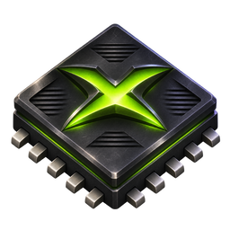

<p align="center">
  
</p>
<h1 align="center">Xenia Edge Afterdark</h1>
<p align="center"><strong>Rebuilding the Xbox 360 experience, not just running its games.</strong></p>
<p align="center">
  <a href="https://github.com/KyokiLuna/Xenia-Edge-Afterdark/releases">Releases</a> ·
  <a href="#what-makes-afterdark-different">What changed</a> ·
  <a href="#development-status">Development status</a> ·
  <a href="#building-from-source">Build from source</a> ·
  <a href="#contributing">Contributing</a>
</p>

> [!IMPORTANT]
> Afterdark is under active development. Milestone builds are experimental prereleases. The combined HDD gate is unfinished; a milestone does not establish complete native profile, avatar, storage or media functionality.

## What is Afterdark?

Xenia Edge Afterdark is an independently maintained, experimental fork of Xenia Edge, itself built on the work of Xenia and Xenia Canary.

Xenia Edge provides an extensive foundation of Xbox 360 CPU, GPU, kernel, user-interface, and networking emulation. Afterdark builds on that foundation with a more specific mission: reproduce the behavior of the Xbox 360 as a complete system, including its dashboard, Guide, storage, profiles, avatars, and eventually the services that games expect from the console.

This is an independent project with its own name and icon. It is not affiliated with Microsoft or an official Xenia Edge distribution.

## What makes Afterdark different?

These are the areas Afterdark is extending or prioritizing on top of the inherited emulator:

| Area | Afterdark direction |
| --- | --- |
| Dashboard, Guide & XUI | Prioritize native Xbox 360 system UI behavior, controller/keyboard handoff, notifications, and correct return-to-title/dashboard lifecycles. |
| HDD, content & profiles | Treat storage devices, content packages, local identities, gamer pictures, settings, and saves as persistent console systems. |
| Avatars | Reconstruct the installed avatar resource and editing/rendering paths so dashboard, games, and local profiles agree on the same data. |
| Xbox Live-like features | Work toward an independent, direct peer-to-peer social layer for friends, presence, messages, invites, sessions, parties, and voice. This does not provide access to Microsoft Xbox Live. |
| XNA & system applications | Investigate correct XNA/Indie-game runtime loading and the system applications expected by the original console. |
| Media & libraries | Develop shared Xbox-style content/storage surfaces, host-media import, native browsing and playback. |
| Accuracy & performance | Repair shared emulator behavior, measure regressions, and pursue constrained resource usage and Steam Deck-class performance. |

Core rule: reproduce the Xbox 360's shared behavior. Missing console behavior must remain visible and diagnosable.

The [console fidelity and overhead policy](docs/research/17559-console-fidelity-policy.md)
is a standing rule: host-only work needs a concrete emulation reason, and
unnecessary diagnostics are disabled with their code retained for later use.

## Development status

The project is developed in tested milestones. The [implementation roadmap](docs/research/17559-roadmap.md) and [gate/release policy](docs/research/17559-gate-releases.md) describe the larger plan.

| Subsystem | Current state |
| --- | --- |
| Guide / shared XUI & XAM foundation | Locally tested on Linux; remaining native scenes and service-dependent behavior still require integration. |
| HDD, local profiles & saves | In progress. Managed storage, persistence and recovery have engineering test coverage; the combined HDD gate remains incomplete. V62 separately recorded local profile creation/reopening and BO1 settings persistence. |
| Native account/profile UI | Integration and runtime validation remain in progress. Native sign-in and profile/avatar initialization are not established as working across the requested scenarios. |
| Avatar system | Stock appearance/preview data is present in local profile work; full 3D rendering, editing, persistence and game consumption remain unfinished. |
| Media & libraries | Part of the combined HDD gate. Reference/import and catalog work is under development; complete native playback and seeking remain unverified. The native AAC route still needs the Optional Media Update package. |
| XNA / Xbox Live Indie Games | The supplied launcher title update is the primary reference. XNA review follows the HDD test AppImage/source sync, before gate closure and Live work. |
| Direct P2P social / Live replacement | Planned and under research; not a working public Xbox Live replacement. |
| Remaining system apps & online-service compatibility | Later milestones, dependent on the system foundation. |
| Performance and broader compatibility | XMA, GPU and CPU console-fidelity review follows XNA before HDD gate closure. No game-wide FPS or compatibility guarantee. |

The [HDD checkpoint notes for 2026-11-23](docs/research/17559-hdd-milestone-20261123.md) describe the current integration, validation boundaries and remaining work. Its release bundle carries the actual engineering and AppImage acceptance records. The [2026-11-18 milestone notes](docs/research/17559-hdd-milestone-20261118.md) remain available as a historical record.

Current source progress and the unresolved native sign-in/shutdown failures are recorded in the [Guide regression report](docs/research/17559-checkpoint-guide-regression-20261123.md). The [2026-11-25 source backup](docs/research/17559-source-backup-20261125.md) saves the newer work and an explicitly unapplied research draft; it does not add a checkpoint release or close the HDD gate.

The [V62 checkpoint notes](docs/research/17559-hdd-profile-checkpoint-v62.md) remain a historical record of its Linux profile-persistence and Call of Duty: Black Ops storage/control-setting tests. V62 is a public prerelease; its results do not establish acceptance of later native profile or avatar work.

## Upstream integration

Upstream patches are included only after review shows that they support
Afterdark's project goals and system contracts. Changes that conflict with
those goals are excluded, even if they are useful in upstream Xenia Edge.
Upstream origin, a clean merge or a working host-side alternative is not
approval to include a change.

For media, the target is the Xbox 360's native browser and player, connected to
its storage, installed resources and guest services. Host import supplies that
console path. An external media player or a replacement host playback window
does not satisfy this goal or its acceptance tests.

See the [upstream integration policy](docs/research/17559-upstream-integration-policy.md)
for inclusion criteria and the required decision record.

## Project priorities

- Console-first correctness: implement shared Xbox 360 interfaces and preserve authentic behavior, including failure cases.
- Reliable persistent state: protect profiles, saves, installed content, and system files from regressions.
- Measurable efficiency: keep memory and CPU/GPU overhead under discipline, with Steam Deck-oriented performance as a development target.
- Independent networking: pursue direct peer connections without pretending to authenticate against Microsoft services.
- Shared fixes: repair system contracts and validate actual behavior across their consumers.

## Platforms & releases

Linux x86-64 AppImages are the current testing distribution. Milestone releases are experimental prereleases, with matching source archives and validation notes. Use isolated or backed-up data when testing unfinished HDD work.

The finished combined HDD gate will receive a stable release only after its mandatory acceptance scenarios pass. No stable Afterdark release is available yet.

macOS is a target platform; native execution and packaging remain unverified. Windows releases are not planned for Afterdark. Windows-related files inherited from Xenia Edge may remain in the source tree.

Find builds on the [Afterdark Releases page](https://github.com/KyokiLuna/Xenia-Edge-Afterdark/releases). Upstream Xenia Edge releases are separate distributions.

## Building from source

For developers comfortable with an unstable work-in-progress checkout:

```sh
git clone --recurse-submodules https://github.com/KyokiLuna/Xenia-Edge-Afterdark.git
cd Xenia-Edge-Afterdark
./xb slang
./xb setup
python3 tools/research/apply_source_patches.py
./xb build --config=release
```

The patch step preserves the FFmpeg XMA overlap correction used by Afterdark's builds. It checks the complete original and corrected source hashes, accepts the already-corrected file, and refuses unexpected bytes. The pinned component revision and patch are recorded in [the FFmpeg patch manifest](third_party/patches/FFmpeg/manifest.json). Run this step after initializing submodules and before building.

GitHub's automatic source archives do not contain submodule payloads. For a recursive Git checkout, initialize the pinned submodules with `git submodule update --init --recursive`; for a downloaded milestone source archive, follow its accompanying source/provenance instructions.

The project has substantial system dependencies. Read [the build prerequisites](docs/building.md) and inspect the [Linux build workflow](.github/workflows/build.yml). Some inherited documentation may still refer to the upstream repository; use this fork when checking out Afterdark.

Build success is not proof that a particular game, platform, native dashboard path, or network service works.

## Contributing

Contributions should make the emulator behave more like an Xbox 360. Useful changes reproduce, document, or test an actual console interface or shared behavior. Avoid title-ID conditionals, arbitrary compatibility hacks, fabricated service success, and changes that trade away correct state or lifecycle behavior to make one test pass.

Before proposing a change, provide a reproducible case, the console/system behavior being modeled, and relevant regression checks. Keep changes reviewable and follow the [existing contribution guide](.github/CONTRIBUTING.md) and [style guide](docs/style_guide.md). Do not submit information derived from Microsoft XDKs.

Issues should include a concise reproduction, host OS, build/commit identity, expected versus actual behavior, and logs when useful. Do not upload copyrighted games, system binaries, private profile data, or credentials.

## Credits, licensing & artwork

Afterdark depends on years of research and engineering by the original Xenia, Xenia Canary, and Xenia Edge contributors. Credit belongs to those projects for the functionality this fork inherits.

Source code is provided under the repository's 3-clause BSD license, with third-party components retaining their own licenses.

The distinctive Afterdark icon adapts the existing Xenia/Edge artwork and is documented separately under CC BY-SA 4.0. See the [artwork credits and license](assets/icon/afterdark/README.md) and [source/provenance notes](assets/icon/afterdark/PROVENANCE.json).

No Xbox 360 game, dashboard, firmware, user account, or Microsoft service is included or provided by this repository.

<p align="center"><strong>Xenia Edge Afterdark</strong><br />Console behavior first. Everything else follows.</p>
