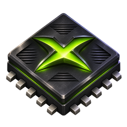

  

<h1 align="center">Xenia Edge Afterdark</h1>

<strong>Rebuilding the Xbox 360 experience, not just running its games.</strong>

  <a href="https://github.com/KyokiLuna/Xenia-Edge-Afterdark/releases">Releases</a> ·
  <a href="#what-makes-afterdark-different">What changed</a> ·
  <a href="#development-status">Development status</a> ·
  <a href="#building-from-source">Build from source</a> ·
  <a href="#contributing">Contributing</a>

[!IMPORTANT]
Active development — V62 is available as a prerelease, not a stable release. The HDD gate checkpoint 62 is a Linux x86-64 testing build. This is an experimental emulator, and features described as goals or work in progress are not promises of current functionality.

What is Afterdark?
Xenia Edge Afterdark is an independently maintained, experimental fork of Xenia Edge, itself built on the work of Xenia and Xenia Canary.

Xenia Edge provides an extensive foundation of Xbox 360 CPU, GPU, kernel, user-interface, and networking emulation. Afterdark builds on that foundation with a more specific mission: reproduce the behavior of the Xbox 360 as a complete system, including its dashboard, Guide, storage, profiles, avatars, and eventually the services that games expect from the console.

This is not an official Xenia Edge release, a rename of Xenia Edge, or a Microsoft-affiliated project. The separate name and icon are intentional.
What makes Afterdark different?
Rather than presenting inherited Xenia Edge functionality as new work, these are the areas Afterdark is extending or prioritizing:
Area	Afterdark direction
Dashboard, Guide & XUI	Prioritize native Xbox 360 system UI behavior, controller/keyboard handoff, notifications, and correct return-to-title/dashboard lifecycles.
HDD, content & profiles	Treat storage devices, content packages, local identities, gamer pictures, settings, and saves as persistent console systems rather than disconnected features.
Avatars	Reconstruct the installed avatar resource and editing/rendering paths so dashboard, games, and local profiles agree on the same data.
Xbox Live-like features	Work toward an independent, direct peer-to-peer social layer for friends, presence, messages, invites, sessions, parties, and voice; not access to Microsoft Xbox Live.
XNA & system applications	Investigate correct XNA/Indie-game runtime loading and the system applications expected by the original console.
Media & libraries	Develop the Xbox-style content/storage surfaces alongside host-side browsing and playback where the console contracts require them.
Accuracy & performance	Fix underlying shared emulator behavior, measure regressions, and pursue constrained resource usage and Steam Deck-class performance without game-ID-specific hacks.

Core rule: reproduce what the Xbox 360 does. Do not hide missing console behavior behind per-game shortcuts.
Development status
The project is built in staged, tested milestones. The [implementation roadmap](docs/research/17559-roadmap.md) and [gate/release policy](docs/research/17559-gate-releases.md) track the technical detail.
Subsystem	Current state
Guide / shared XUI & XAM foundation	Locally tested on Linux; remaining native scenes and service-dependent behavior still require integration.
HDD, local profiles & saves	In progress. Local checkpoint testing includes creating a profile, reopening it, and retaining profile data across restart. The combined HDD gate is not finished.
Avatar system	Stock appearance/preview data is present in local profile work; full 3D rendering, editing, and game consumption remain unfinished.
XNA / Xbox Live Indie Games	Future integration and validation work; not a completed Afterdark feature.
Direct P2P social / Live replacement	Planned and under research; not a working public Xbox Live replacement.
Media, remaining system apps & online-service compatibility	Later milestones, dependent on the system foundation.
Performance and broader compatibility	Ongoing research and regression testing; no game-wide FPS or compatibility guarantee.

The [V62 checkpoint notes](docs/research/17559-hdd-profile-checkpoint-v62.md) document Linux tests including local profile persistence and Call of Duty: Black Ops storage/control settings. V62 is now published as a public prerelease. The combined HDD gate remains unfinished; publishing a checkpoint does not make it stable.

Project priorities
- Console-first correctness: implement shared Xbox 360 interfaces and preserve authentic behavior, including failure cases.
- Reliable persistent state: protect profiles, saves, installed content, and system files from regressions.
- Measurable efficiency: keep memory and CPU/GPU overhead under discipline, with Steam Deck-oriented performance as a development target — not a proven promise for every game.
- Independent networking: pursue direct peer connections without pretending to authenticate against Microsoft services.
- No game-specific camouflage: prefer fixes that explain and repair the actual emulated system contract.
Platforms & releases
Available prerelease: HDD gate checkpoint 62 (V62)
V62 is an experimental Linux x86-64 checkpoint for testing, not a stable release.
- V62 prerelease page
- Linux x86-64 AppImage
- Matching source.zip
- [V62 testing notes and SHA-256 hashes](docs/research/17559-hdd-profile-checkpoint-v62.md)
Locally reported/tested behaviors include BO1 automatic storage selection, controls persisting across restarts, a corrected title mode-switch/exit path, and creating and reopening a local profile using installed stock assets. This does not establish full avatar rendering, the entire HDD/storage system, macOS functionality, or the P2P social layer.

No stable release is available. Future release targets include:
- Linux: additional tested x86-64 AppImage builds with matching source archives.
- macOS: a target platform, with native execution and packaging still requiring validation.
Windows releases are not planned for Afterdark. Windows-related files inherited from Xenia Edge may remain in the source tree; their presence does not indicate an Afterdark Windows distribution.

Find all future builds on the Afterdark Releases page. Do not use upstream Xenia Edge release links as Afterdark downloads.
Building from source
For developers comfortable with an unstable work-in-progress checkout:
git clone --recurse-submodules https://github.com/KyokiLuna/Xenia-Edge-Afterdark.git
cd Xenia-Edge-Afterdark
./xb slang
./xb setup
./xb build --config=release
The project has substantial system dependencies. Read [the build prerequisites](docs/building.md) and inspect the [Linux build workflow](.github/workflows/build.yml). Some inherited documentation may still refer to the upstream repository; use this fork when checking out Afterdark.

Build success is not proof that a particular game, platform, native dashboard path, or network service works.
Contributing
Contributions should make the emulator behave more like an Xbox 360. Useful changes reproduce, document, or test an actual console interface or shared behavior. Please avoid title-ID conditionals, arbitrary compatibility hacks, fabricated service success, and changes that trade away correct state or lifecycle behavior to make one test pass.

Before proposing a change, provide a reproducible case, the console/system behavior being modeled, and relevant regression checks. Keep changes reviewable and follow the [existing contribution guide](.github/CONTRIBUTING.md) and [style guide](docs/style_guide.md). Do not submit information derived from Microsoft XDKs.

Issues should include a concise reproduction, host OS, build/commit identity, expected versus actual behavior, and logs when useful. Do not upload copyrighted games, system binaries, private profile data, or credentials.
Credits, licensing & artwork
Afterdark depends on years of research and engineering by the original Xenia, Xenia Canary, and Xenia Edge contributors. Credit belongs to those projects for the functionality this fork inherits.

Source code is provided under the repository’s 3-clause BSD license, with third-party components retaining their own licenses.

The distinctive Afterdark icon adapts the existing Xenia/Edge artwork and is documented separately under CC BY-SA 4.0. See the [artwork credits and license](assets/icon/afterdark/README.md), icon license, and [source/provenance notes](assets/icon/afterdark/PROVENANCE.json).

No Xbox 360 game, dashboard, firmware, user account, or Microsoft service is included or provided by this repository.

<strong>Xenia Edge Afterdark</strong> Console behavior first. Everything else follows.

