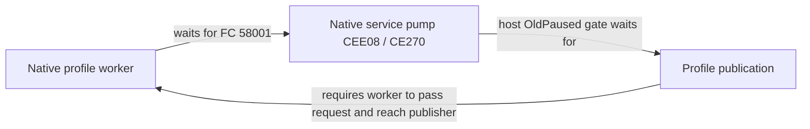

# 17559 profile lifecycle compared with current Afterdark

Status: V134's prepared-ingress, cancellation and terminal-retirement change
builds and passes all seven direct test runs. Its actual dashboard/Guide run
still failed. Memory stayed near 704 MiB through the six-minute test, but the
Guide remained invisible while initial native reconciliation waited inside its
continuation. The process exited one after an ordinary window close and a
Bootstrap thread-join timeout, with clean reaping and no forced signals. No
usable checkpoint or native shutdown pass is claimed. V133's earlier false
pre-entry uncertainty and memory-guard failure remain recorded below.
Historical V130–V132 findings remain labeled below. The combined HDD gate is
open. This work follows
the standing [systems approach and
console fidelity rule](17559-console-fidelity-policy.md).

The initial comparison used V130 source map
`3a7c6c7a567210b67bef7b245183cb99a8002242b51cd2c6071e07216fc652a7`.
The last tested V131 source map is
`484392c97d89ca8e5a5ec72a7d4a9ce6fa74d654471b08255efae951ed5a70dd`
(2,430 source files). Its seven direct test runs passed under receipt
`cbe73dba7fac660411547ee2a44184490d5a138df395886dcf0f85f8d133ef0c`.
They establish their component coverage; they do not establish native profile
creation, sign-in, appearance editing or game rendering.

The primary runtime reference is the matching 17559 XAM image, SHA256
`f9e44cd6f4b04875ddc5a3b8fd519785ba2b0488b1c4622f818b740ba4064313`.
Existing executable maps and pinned contract reports supply the other body,
resource and consumer facts. Different dashboard versions retain their own
identities. No supplied executable, profile payload or console key is added to
this source document.

## Actual system boundaries

Afterdark currently combines original guest XAM/UI bodies with shared host
storage, Account, GPD and roster services. The host representation serves the
existing emulated file and HLE consumers. It must converge with the genuine
native cache and completion, rather than acting as a second independent
profile implementation.

| Lifecycle phase | Matching native contract | Current implementation and remaining obligation |
| --- | --- | --- |
| Discover and select | Native profile enumeration, actual user/device and asynchronous result ownership precede sign-in. An in-progress list count is not completed inventory. | Registered writable sources, authenticated Account snapshots, leased inventory and ordinary folder mounts are active shared services. Native and host UI must preserve the same user/source. An intermediate zero count does not establish deletion. |
| Load Account/GPD | Mounted profiles supply the selected Account and settings; successful loading is distinct from sign-in. | The active mount is a folder-backed HostPathDevice with Account service and normal GPD files/cache. This path does not require native CON raw-Header parsing. V130 preparation passed; legacy Header format is not established as its sign-in failure. |
| Create local profile | Native 230/234 has paired producer/result ownership, then a separate 20B logon request. The genuine cold metadata producer supplies 0x93D6 bytes and has directory effects before its final create call. | The active owned HLE creation recipe writes durable Account/GPD, installed stock pictures and INFO1, but still emits a legacy 0x148 aggregate Header. This is not the native cold-container producer. Preserve the distinction and all existing members during any upgrade. |
| Initial pictures/appearance | MiniCreator chooses actual appearance and later commits it through the profile services. | Installed stock tiles, preset previews and a 1,000-byte INFO1 default exist. A preview or gamer picture is not evidence of an attached, animated avatar model; native default timing/equivalence still needs acceptance. |
| Sign-in/out ingress | 20B at 0x8199C630 and 224 at 0x8199E3E0 retain original caller, flags, user slots and sync/async result policy. | PM preparation, exact Account/source comparison, original-call execution and old/new roster ownership exist. Actual V130 failed at native Schedule producer binding, after preparation. Entering or returning from the generic executor does not alone authenticate native completion. |
| Request to Task | Null-overlap 224 uses stack output bodySP+0x5C; nonnull-overlap 224 uses the genuine native request packet+0x18. E148 has its own stack producer. Tail adapter 0x81671C18 preserves SP/LR. | V131 binds the actual typed producer, retains its scalar birth receipt through native close/free/reuse and avoids later packet dereferences. Its real asynchronous initializer returned zero; later worker/protocol/publication completion remains unobserved. |
| Native publication and errors | Actual worker, native cache publication, protocol result and caller completion are distinct. Native initializer errors and canceled workers have their own paths. | Requested inputs and proven terminal outcomes remain separate. V132 observed real publication and completion without final settlement. V133 encountered an earlier startup handoff failure. Neither run establishes complete native sign-in, Guide or shutdown acceptance. |
| Complete and release | CompleteIO 0x816A2588 atomically claims the native context, closes its actual tagged Task and frees the packet at 0x816A26E4 before returning. | The original overlap, callback, Task and source owners must remain distinct. A new host packet pin extending to Schedule/224/CompleteIO return could obstruct native free. No later packet dereference or fabricated Task birth may be justified by an earlier pointer alone. |
| MiniCreator and foreground Editor | Mapped wizard phases invoke Mini UI 6A4 or Editor launch 7DB. Mini requires an owned request/visibility/cancel/teardown lifecycle; its FE21018 queue-copy proof remains unclosed. Editor is a genuine foreground TITLE. | The paired SYSTEM 7DB handoff and TITLE-aware avatar owner now exist. Mini execution, actual title handoff, return/home and real attachment remain unaccepted; older claims that 7DB and LoadAnimation are absent are superseded. |
| Persist appearance and tiles | Mini and Editor SetManifest calls are followed by actual ProfileSync 21F; tile workers also use 2F1/2FB with their own buffer semantics. ProfileSync is a user mask. | Shared INFO1/GPD and picture transactions exist, but external 21F/2F1/2FB routing is incomplete. SAVE49/Header/PIS05/real IO-close/cache promotion is inactive. A successful SetManifest helper does not prove native save/restart. |
| Native container creation/save | Native metadata, aligned Header bytes, real descriptor/checkpoint controls, file writes/close and cache promotion are one producer/consumer chain. | Existing authenticated native CON/aligned-Header support is active. Cold creation and complete native save remain separate missing participants. Preserve actual padding, unknown fields and source identity; do not manufacture formatted state or control success. |
| Render and consume avatars | F2/F3 native engines serve initialization, appearance, assets, geometry and animation for dashboard, Editor and games. | Ten native engine/profile/animation routes exist, including actual TITLE callbacks. Remaining custom/mipmap/icon/binary/enumeration/WearNow paths still contain incomplete behavior. Actual stock models, editing, animation and Doritos consumption remain mandatory runtime checks. |
| Rename/delete | Native APIs must coordinate Account, Header, catalog, roster and storage outcomes. Profile-only deletion preserves owned game saves. | Host deletion and registered selected-package export 270 now share source-bound package/Header removal, recovery and matching cache handoff. Seven added cases passed, including actual export completion, reader/writer conflicts, two sources, restart and save preservation. Native 233 whole-user traversal and external rename/save/load remain separate open work; dashboard UI deletion has not been accepted. |
| Restart and recovery | Durable completion must survive restart and fresh enumeration with the same identity, settings and appearance. | Component journal replay, exact source binding and cache validation are tested. Current native save/restart and full profile lifecycle acceptance remain open. A flush, cached row or clean exit is insufficient by itself. |

Three native terminal outcomes need separate treatment. An initializer error can
complete the original overlap without a successful worker birth, after genuine
provisional native presence changes. The C838 cancellation branch publishes
four reset rows through 0x8199DA34/return 0x8199DA38; this is an empty native
outcome, not necessarily the old or requested roster. The normal publisher can
also follow per-user adjustments. Its actual rows must match a proven outcome
before host settlement. The original requested roster and expected baseline
stay immutable; unproved partial outcomes remain explicitly uncertain.

## Coherent implementation and validation units

1. **Original identity/request lifecycle.** Cover 20B/224, native sync and async
   producer outputs, actual allocation/publication/birth, E148/C838 workers,
   initializer errors, cancellation, protocol/cache publication, CompleteIO,
   Task and packet release, and old/new source plus visible identity convergence.
   Existing original callers, read scopes and native completion remain authoritative.
   Required cases include worker completion before Schedule return and failures
   before a child Task exists. The output-location check alone is not this unit.
2. **Durable profile/container lifecycle.** Cold creation requires its actual
   metadata producer and source-issued provisional participant. Saving an existing
   authenticated native CON can proceed independently through the complete
   multi-GPD/picture/Header/IO-close/PIS05/cache-save unit and its own before-token;
   cold creation is not a universal prerequisite for that path. Missing or legacy
   Headers require their separate proven creation/repair participant. Close real
   external profile APIs from their ABIs through those shared services. Reuse
   common package/Header deletion and preserve a durable result through cache
   contention. Ordinary bridged folder reads remain valid independently of raw
   CON support.
3. **Avatar lifecycle and consumers.** Use the working identity and persistence
   contracts for MiniCreator, actual Editor attachment, remaining native asset
   operations, save/reload, dashboard/Guide and a real game consumer. Preserve
   actual native blobs, unknown fields and both body types. Tiles and component
   tests cannot substitute for models, advancing animation or restart identity.

These are dependencies within the existing combined HDD gate, not new gates or
permission to postpone its mandatory scenarios. Independent units can be
implemented in parallel after their shared interfaces are established. A
checkpoint requires an actual usable dashboard/sign-in/game-save/Guide/exit
path and a test of the packaged AppImage itself; the current V131 run does not
satisfy that requirement.

## V131 integration and actual consumer result

The nine-file implementation covers typed producer output, Task/birth lifetime,
initializer return/error ownership, actual requested or canceled publication,
old-model writer drainage and final resource retirement together. Twelve new
cases passed alongside all existing selected cases. Direct runs passed base
331/28,245 assertions, network 125/11,212, kernel 1,448/91,190, VFS 136/9,736,
UI 124/4,863, focused CPU 5/130 and focused installed-system 179/21,427. The
installed selection explicitly included three hidden cases. Focused runs overlap
full-suite coverage; the CPU instruction corpus was not run in full.

In the actual isolated ELF run, unsigned dashboard and native Guide/profile
list rendered. Selecting disposable local123 requested slot 1. The actual native
initializer returned zero without the former producer-binding denial or
execution-uncertain result. A genuine C838 Task/read/commit record was observed;
protocol, roster publication and owned CompleteIO were not. The dashboard stayed
unsigned, and later Guide input did not reopen the overlay. This is a failed
sign-in lifecycle test, despite the successful initializer and component tests.
The next review follows the whole worker/wake/publication/completion chain.

An ordinary owned WM close was requested. The process exited one after 425.05
seconds, with complete reaping, no forced signals and checked inputs preserved.
Successful host cleanup is not successful native shutdown. Avatar Editor,
game/save, actual packaged AppImage and combined gate acceptance remain open.
MangoHud and GameMode were disabled; original user data was not used.

| V131 record | SHA256 |
| --- | --- |
| Coherent source freeze | `2b4ed71a97b20eb387ce1402dd0e97ca7035e0c5e95f53e9c876c471a42c3102` |
| Source application | `ce437e2b25af79fedfac657eb5493a95da785055bb9d8aa791c4d92f3dd064cf` |
| Build | `b980534af4c408c4d76f6535fa23ca872c3567408c67632a0c6115d557ddf09f` |
| Seven direct runs | `cbe73dba7fac660411547ee2a44184490d5a138df395886dcf0f85f8d133ef0c` |
| ELF | `e116016a6ff865a4de3a0aa5ba660b52bf92807935c93e5ccb2d3b27606ac378` |
| Actual runtime result | `bc26d56c7110a0adb40068f0063bc9767b5dd82930da5cd046d2044d284b751d` |
| Root visual/cleanup assessment | `f660e124ca1a43ca1257c607a3a930223a222bc6248b06a59d47164b612d7eb6` |

## Observed V131 native service-progress dependency

Subsequent runs used the same qualified V131 ELF and all 2,430 tested source
blobs, now saved in fork commit `7fac23c28f11f8d6bd5a4702205107ab9fb4090b`.
The latest run proves which request holds up the worker: app `0xFC`, message
`0x58001`. A bounded, read-only capture verified the actual worker's pending
single-event wait, original A2898 and A2CF0 stack frames, pending result 997,
matching event and issuer `0x818309A0`, plus the issuer's complete code bytes.
This is a source-bound request identity, not an inference from the host toolbar
or a dump of account/request payloads. No envelope-header fallback was needed.

The native FC handler already retains the request. Its CE270 consumer runs the
real XNet task and completes through original A2588, including native event,
Task and packet cleanup. HLE `CompleteOverlapped` or a successful callback return
cannot substitute for that lifecycle. The matching default C310 producer's four
zero user rows and flags `0x14` are source-derived facts, not captured request
arguments. They do not justify adopting a roster, inventing offline success,
or reporting an authenticated Live connection.

The matching default service graph exposes a dependency cycle:

FC's periodic CEE08 callback invokes the pending-request consumer, but the
V131 host treats the whole CEE08 body as an ordinary data consumer and
parks it until publication. CEE08 also has other consumers, so exempting its
entire body is not established as safe. The coherent unit below preserves
those data/source duties while allowing the request's real service progress,
including repeated pending ticks, actual backend results, completion and
cancellation. Actual pump execution/PC was not sampled; the cycle above is the
source-defined default path joined to the observed pending FC request.

No missing-CRT claim is made: the current startup plan's heap initialization
transitively includes the FC constructor, and deferred native service startup
registers/initializes FC and schedules its pump. A bare static pointer is not
evidence of runtime readiness. The current plan contains 16 catalog phases and
62 call entries; older 14/57 counts are historical.

The latest isolated run closed with exit zero after 272.39 seconds, with clean
owned teardown, no forced signals and checked inputs preserved. Native roster
publication, CompleteIO and sign-in still have no passing result. Earlier V131
exit-one runs remain failures. The combined gate and replacement AppImage are
still open; no new build or packaged acceptance is claimed by these diagnostics.

| Observed V131 record | SHA256 |
| --- | --- |
| Exact pending-channel observation | `8dada4c2c564529717d7d0e70cc508613fc91aab895c870477f3fb7fa7305802` |
| Latest actual runtime result | `634b3b2c624beecf2e54723eb4de13639ef9a5c523e906d709e551fcd64c3286` |
| Native request/completion lifecycle | `98eb47e379e47fd01e496e6fac52ddd5f86d0ca0d595477fb53b7a739b8f7ee8` |
| Native FC producer/backend/completer | `c15d799ef6d1f1f4e088cf1d665a772d8171229c42b96cb4c5934f7f760b7a81` |

## V132 implementation and actual validation

The ten-file unit binds the actual C838 operation to its original FC producer,
copied request, provider acceptance and native periodic Task. It admits the same
whole CEE08 frame for recurring pending ticks, including a frame already parked
before acceptance. Service progress carries lifetime ownership; it supplies no
profile read, writer, listener or descendant authority. A known enclosing read
is suspended through its actual owner and restored at the correct Task boundary;
an unknown read cannot be borrowed. Existing signed-in users are not excluded by
an invented empty-roster prerequisite.

Original native backend results, completion, event/APC behavior, Task close and
packet free remain responsible for the operation. Exact per-thread scalar
bindings cover both profile and avatar hooks at entry, own-return and the native
publication cut. They avoid unrelated host observer locks at those cuts while
preserving distinct native Task destruction. Request, thread, module and source
owners remain through real returns or actual CPU stop; escaped holders have the
same explicit resource retirement. Final service joining occurs after native
publication, without adding a publication barrier that recreates the cycle.

The composition also skips full common Task code validation at instruction cuts
where no eligible retained observation can be affected. Participating work still
receives the original full proof. This changes neither the proof into a cache nor
native results. No timing, FPS or native sign-in improvement has been measured.

All existing literal test names, tags and bodies are preserved. Eleven added
cases exercise actual production metadata, Task ledger, copy lifetime and read
cells. The source-derived selections contain 1,459 default kernel cases and 190
installed-focus cases, including the same three explicitly selected hidden cases.
All seven direct runs passed: base 331/28,245 assertions, network 125/11,212,
kernel 1,459/91,982, VFS 136/9,736, UI 124/4,863, focused CPU 5/130 and
installed-focus 190/22,219. Focused runs overlap full-suite coverage. Static
review, compilation and these component tests are not native acceptance.
The completed build contained 341 steps and 322 compilation units because the
per-thread binding changes a shared CPU header. All seven targets are requested;
network and VFS products are checked unchanged when absent from the link plan.

| V132 source/build input | SHA256 |
| --- | --- |
| Reviewed composition | `621f666da7d5a02fd9ee8fc9b675b55e441e3410ad12e6a638a28fdd60659a13` |
| Source map, 2,430 files | `b97ae7ebd68287ec1513d3ec3e91d66e7f488285f4f783220b7ca89c00bfb0c9` |
| Actual source application | `f60c3ba4d4a3364622f8afd02e2057a2cee173115be54e50aeb4e254e5e8a4f2` |
| Build/test qualification manifest | `fd5b9d7d64576edfe3315ee868a18375fd6107799e0c05de1a983b332deeff98` |
| Completed build | `ea9378520430698c8e5adde45d0a583df9262adfab3543c7711f67967785dbb7` |
| Built ELF | `dba714badc3999a35db27cf3a19c1af4748887e2273d337db05c01eb34c380bf` |
| Seven direct runs | `c8b78f00691c5ad280e9b64317634524f27e7b7dc5322195bc15a25223163b0d` |

In the isolated native run, Guide was visible before selection. Selecting
local123 reached a dashboard that displayed that profile's name. Repeated Guide
requests then produced no visible Guide; Back followed by Right visibly changed
dashboard focus. The toolbar's unsigned slot zero is not evidence about selected
slot one. The real initializer returned zero, and the native worker returned
`0x80150013`. Original CompleteIO entered and returned with Win32 `0x65B`, that
same extended value and length zero. Native maps and writers became available.
Settlement stages 7/8 were not captured. These facts establish new native progress,
not successful sign-in or authenticated Live service.

All eleven initial final-readiness predicates eventually passed. The recorded
post-request Query still lacked the actual prepared Source-retirement result;
it did not evaluate later joins. Sampling is bounded, so this does not assert
that every later Query failed identically. Whole-contract review mapped
PollOnNativeTask through actual callback/output, GPU, session, Source and native
invocation retirement, then separate presenter drain and PM final Open. The
next observation must identify the exact Poll refusal and pending control state.
No missing receipt may be replaced by an inferred GPU completion.

The process exited one after 546.58 seconds following Root's owned normal window
close, fully reaped with no forced signals. This stop's first reported refusal is
the Xmsg retained-stop predicate, which exposes no `stopping/retired/hooks` tuple.
No hook leak or failing identity conjunct is established by that report. Native
`0x80150013` branch provenance is mapped, but its actual producer parameter/state
was not captured; no semantic error name or network cause is assigned.

| V132 native record | SHA256 |
| --- | --- |
| Actual runtime result | `a95bce19e94d2ceb37a01d46fce92ed35ef809a54fe74ee11d63284d86be03ac` |
| Root visual/scalar assessment | `9da7ac7b66ca0086f280deba1e754c7496cb72362831c90183e46a0013569661` |
| Whole prepared-source contract review | `19643da87322a0e7b78f8b1f612347c6d6520617d4f9fade7b38d51a7a32275f` |
| Separate Xmsg stop contract review | `dd5d3c7f43d58500c84d73a20bdd3e8f9808da7711389bd4667d217369d1ac1c` |

The dirty index, README, existing user data and previously qualified artifacts
remain preserved. A replacement checkpoint still requires successful current
direct tests, actual native dashboard/game checks and packaged AppImage tests.

## Distinct profile deletion operations

The matching native 233 path constructs `Content\\XUID\\` with flags `0x200`;
it does not stop at the profile's package. Its recursive operation can include
owned saves. Replacing it with the host profile-only operation would also change
its default-device handling, callbacks, partial results and sign-out policy.

The dashboard has a separate selected-package branch. Whole function `92300760`
selects export 270 for profile content type `0x10000`, operation 4 and choice
field `+0x114 == 1`; its other branch calls 233. The field receives an incoming
choice and defaults to one, but the visible localized label and caller binding
have not been proved. These are static primary-code findings, not a tested UI
operation. A virtual raw profile CON is one non-directory item within the outer
traversal; its individual removal can later use a shared package/Header owner
while preserving the original following callback.

V133 replaces the host path's raw removal and late cache-admission failure with
one retained source-issued operation. It owns the exact package and external
Header through durable removal, recovery and matching cache handoff. Existing
host deletion retains its requested sign-out policy; production export 270 uses
the same service without implicitly signing a player out. Native 233 remains
unchanged. Cold creation and complete native SAVE remain mandatory open work.

Physical case variants retain their resolved spelling. A cached same-source
canonical variant without proof of the same physical origin is refused before
effects, preserving case-only siblings. Active and retired holders match the
actual managed authority, guest generation, device/source generation and exact
profile view; those are distinct roles. Actual Done seals the original removal
before device retirement, and a pending journal retains its namespace claims
even when the caller drops its receipt.

The direct tests distinguish observation from mutation. An absent-file snapshot
can be valid while a deletion handoff owns the namespace; that observation
grants no write permission. The corrected tests exercise actual mkdir and
Header writes returning Busy without changing bytes, followed by real success
after release or recovery. A signed-in profile's Account reservation causes an
earlier structural source-resolution refusal with ACCESS_DENIED. The unchanged
export completion correctly preserves that error as `0x80070005`; it must not be
rewritten as a later sharing violation just to satisfy a fixture.

| Deletion contract record | SHA256 |
| --- | --- |
| Corrected native 233 scope | `e702ec438e76731e8b76397717776637c5218b9207ec6518179bb0ec2bcc07a6` |
| Separate dashboard package-delete branch | `40b0d5c2a5b5ebd6a2fdff2ad6f9eeb29695cea8acb94fd4f5db0a37c47282a1` |

## V133 tested source and failed native startup

The coherent sixteen-path source map is
`97184d8d94b32b39e71655dfd12802d40ad0c037d56a598df691123730d0a2c8`.
All seven direct runs passed: base 334/28,711 assertions, network 125/11,212,
kernel 1,463/92,881, VFS 136/9,736, UI 124/4,863, focused CPU 5/130 and
installed-focus 194/23,118, including three explicitly selected hidden cases.
The full five suites contain 2,182 cases and 147,403 assertions; focused runs
overlap that coverage. Earlier compile and fixture failures remain recorded.
The corrective source changes affected only two test files, so the successful
four-step rebuild relinked the base/kernel tests and verified the other five
products unchanged. The embedded version retains compilation base `0d28167d`.

The isolated dashboard booted displaying disposable local123 in both dashboard
and host toolbar. The remembered roster selected slot 1; the toolbar name alone
does not identify a controller slot. Guide visibility was notified, but no overlay appeared. This
differs from V132's unsigned-start/explicit-sign-in scenario. The actual owner
was already uncertain at `RunScheduledBody` line 5717, in OldPaused with read
source 2, job/source 3 and one Expected owner. That line combines body failure,
Task return and read-scope leave. Later observations of the same job have its
captured flag clear. That flag includes the monotonic `native_entered` state,
and `ExecutePreparedOn` cannot succeed before setting that state. Together,
these source and trace facts establish a false operation result before native
entry: the first condition short-circuits the actual Task return and scope
leave. They do not distinguish the precise pre-entry refusal or deadline.
Pre-entry admission repeatedly recorded retryable Busy at line 7094. No original
logon, publication, final-readiness or post-want Poll record was observed.

Owned RSS rose from roughly 0.71 GiB to about 6.7 GiB. The memory guard stopped
the run after 190.81 seconds with TERM/KILL cleanup. It was not a normal window
close or a shutdown pass. The record has no remaining live/unverified group
members, but does not prove leader reaping; source, configuration, products,
index and checked read-only inputs remained unchanged. The controller actor was
closed. A later input batch attempted after retirement provides no owned UI
evidence and is excluded from acceptance.

Source review identifies two related boundaries for the next coherent unit:
the callback conflates a failed operation result with its own return duties,
and the host reaper refuses terminal queues after uncertainty while observer
paths can still append to them. Offline ELF debug metadata reports a Work object
size of 22,000 bytes. The recorded next-work serial exceeds 305,000, consistent
with the order of memory growth; this is not a measured retained-object count.
Known pre-entry failures, actual uncertain native execution and already terminal
resource retirement must remain distinct. Cancellation currently refuses while
the scheduled transport is running, so that operation result must reach genuine
transport completion before cancellation and old-source cleanup can finish.
The host's five-second preparation budgets also span unrelated render and
scheduler delays; their role requires review with the entire startup lifecycle.
No guard is relaxed from this finding.

| V133 record | SHA256 |
| --- | --- |
| Corrected coherent source freeze | `48478bcc3e0ff16756f8c13f8b14149374a0eb8e6f69f018165d93a0f3d29ac1` |
| Corrective build | `40ba9b3bfcc918522a3e579061cb8c1350564609dc55d070f6fa4e7fce4ae239` |
| All seven direct runs | `0d486af5e0d8a2d4b308fab0bfb6df8c6de1189b4fb365a547113b6edf36a509` |
| ELF | `e6f527a1bee2cf4ba04e545fd9cc266061151f5df633b068dea912984bd361cc` |
| Actual native result | `ffa51eace54b59e41684394b1c3c19972a13993b2cad8c2cdf9a196534b8d190` |
| Root native assessment | `b3c625d941e9ed4c3e6c02f5ed85e0882f66b6fb9a5f66691a0aef40f24e01f2` |

## V134 tested lifecycle unit and current native result

The five-file change separates a known refusal before native identity entry
from uncertain execution. Its exact operation receipt joins the real callback's
Task/read return and native transport Wait/Close before cancellation can begin.
A rejected Schedule instead requires its actual no-callback cleanup and native
descendant closure; it never receives a fabricated completed handle or callback
return. An allocated, rejected Task closes only after its real native free.
Other unproved generic preflight failures remain conservative holds.

Guest 20B/224 calls supply no timeout argument. Their preparation and initial
bootstrap alignment no longer expire after an invented five seconds of host/JIT
time. Existing cancellation, source/error checks and inherited-lock refusal
remain; explicitly bounded host facade requests retain their host policy.
Completed host records can be reclaimed after unrelated uncertainty, while
active work, pending reads, native frees, references and services keep their
separate ownership requirements.

Seven added cases cover the consumed receipt, actual Task-ledger failure/free
ordering, stale joins, terminal resource retention and deadline policy. The
corrected build and all seven runs passed: base 334/28,711 assertions, network
125/11,212, kernel 1,470/93,136, VFS 136/9,736, UI 124/4,863, focused CPU 5/130
and installed-focus 201/23,373. The five full suites contain 2,189 cases and
147,658 assertions; focused runs overlap this coverage. The first build's two
private-access errors remain failures; the narrow State forwarding correction
preserves the same predicate and existing mutex. Compilation base is `1bd39845`.

The actual isolated dashboard again displayed disposable local123. Guide
visibility was notified, but no overlay appeared; screenshots after B and Right
did not establish input return. RSS stayed between 700.3 and 706.4 MiB after
warm-up, rather than repeating V133's rapid growth. The run ended after 368.22
seconds following an owned window close. Its exit-one Bootstrap join failure is
not a native shutdown pass, despite full process reaping without forced signals.
All checked source, configuration, products, index and system inputs remained
unchanged. Game, Avatar Editor and packaged AppImage checks have not run.

The actual native 224 path reached Schedule at return address `0x8199F01C`
with callback `0x8199C838`. The owner stayed in OldPaused with two Expected
records and no first-loss marker or publication evidence. Static review found
that the service-origin factory requires an optional public request object
which canonical bootstrap reconciliation does not have. Its ensuing actual
producer/Task/read/commit/source/code facts do not consume that object. This is
a verified exclusion in the shared service contract; the trace has not yet
proved that this run reached the FC producer or its wait. No synthetic service
completion or weakened ownership check follows from that finding.

| V134 record | SHA256 |
| --- | --- |
| Tested source map | `64bb91d0dca474c0f8ecd93b8ea425b17836f36253a5cac6974890d2544b80ea` |
| Corrected build | `42dfddfcc77163599015d87d39f0f83fda3abae0a518752fbd8a5ffc77549cfa` |
| All seven direct runs | `f46a5461f90ceaef83beecdc98780ed717b5df5a3286b5da678fa67072812135` |
| ELF | `374c65794780979cf6fd90e4b9e4922d88d43106e623a656d9922b718792cda2` |
| Root native assessment | `8034a251f085743b9b9d0009ad7037216617d3fc22b300e272f15cb5b700bc88` |

The separate closed-file IO checkpoint and logical STFS producer remain private
work. Their candidate reviews do not establish native controls, formatting,
profile save, avatars or media acceptance. No new AppImage has been produced.

## Evidence

Detailed local evidence is retained under `evidence/hdd-gate` in the research
state, with raw runtime data kept private. The following source-bound reports
back this comparison:

| Record | SHA256 |
| --- | --- |
| Current storage lifecycle comparison | `217b5b6bb0dfdea54e09c6c559a431e61275b8cf3701f6883474bf0be1515260` |
| Current creation/avatar lifecycle comparison | `b994e38c78f2d73a2c6b6a7b551fc03d763f9f3e5201241e44bb203af2a73b4d` |
| Independent native producer output/free contract | `9e9ac738300ff00b3dd47c444331533f35721194053a6f1fa0eb9a2ca426af24` |
| Original identity/request lifecycle comparison | `2b9ea61efc760088c256d54094726162429cc03d303172d5a7040bde4f6b4277` |
| Native terminal-outcome supplement | `2d36552571fd3869031cb5312646c8d5afcbe66c0826ec7b376c5958a9e6711f` |
| Actual V130 original-ingress observation | `2679120661c6ee6ef5ebab3a1a5da48bc998fdf50ead367b301565ae3995b933` |

The V130 runtime displayed the unsigned dashboard/Guide and native profile list.
Its first observed denial was Owner8226 at 0x816BA440. The exact failed
subpredicate was not recorded. No authenticated native own-return, protocol,
CompleteIO or roster publication followed. Manual WM close exited zero after
411.18 seconds, fully reaped without forced signals. This observed result and
the static lifecycle findings above remain explicitly separate.
