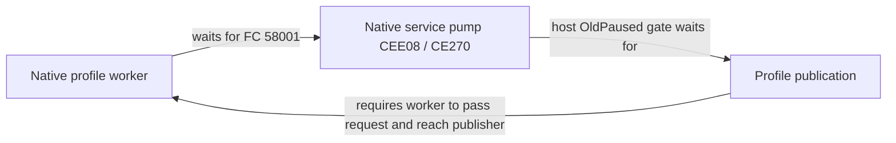

# 17559 profile lifecycle compared with current Afterdark

Status: V145's native loader metadata producer builds and passes all seven
direct test runs. The original setter now executes in the existing prepared
foreground-title transaction. Doritos reaches real native completion, whose
extended/protocol error changed from `0x80150013` to `0x80151000`. Game
continuation still fails and subsequent input reaches the dashboard's
Available Networks screen. The post-handoff dashboard Guide visibly opens,
closes, returns input and reopens while displaying the existing local user.
The timed WM close produces actual exit one: OS cleanup completes without
forced signals, but the native stop contract fails. Offline/online policy,
failed-roster refresh/settlement and ordinary transport teardown are now being
reviewed together. No networking cause is inferred from the error number or
screen alone.
V140's historical actual dashboard/Guide regression passed:
visible first open, B close, dashboard input return, full reopen, Media
navigation, second close and manual normal shutdown. Ordinary profile
selection, game continuation, avatars, Editor and OSK remain unaccepted in
V140. Its Doritos retest rendered, canceled and reopened the native picker,
then selected the intended existing profile. The test supervisor received
SIGTERM before the continuation check and terminated Xenia. The signal's
sender is unknown; this is not a recorded guest crash or native shutdown pass.
Both V141 and V142 reproduced the sign-in stall through a follow-up A press.
The selected issuer is a genuine readless native Task. V142 identifies the
other dispatcher as a healthy Boot1 service execution with no issued old
read/borrowed/Commit ownership. Its lifetime already does not block the later,
more destructive dataful join, yet prevents early initializer admission. The
old listener's three references are exactly its producer and two authenticated
passive public-A notification queues, without active/unknown/orphan/whole-work
consumers. These are lifetime dependencies, not evidence of an old-profile
read. V144 corrects both shared predicates while retaining actual readers,
writers, causal pins and dataful completion duties. V141's manual close failed
at the Avatar current-root guard; V142 and V144 exited zero with full reaping
and no forced signals. Normal exits do not establish a fix for the earlier
Avatar refusal or every shutdown branch.
No new AppImage or usable checkpoint is accepted; the combined HDD gate
remains open. Historical results below keep their own scope.
This work follows the standing [systems approach and console fidelity
rule](17559-console-fidelity-policy.md).

The initial comparison used V130 source map
`3a7c6c7a567210b67bef7b245183cb99a8002242b51cd2c6071e07216fc652a7`.
The current tested V145 source map is
`ad213c527f681c4da2d2e336eb100f5d91d5a886668eb72b5e3b2e6cc24f9133`
(2,430 source files). All seven direct runs passed under receipt
`421457af3b8487efba2b2029d25de3282977ef8a3762a1d4723d6f594fc39b7b`.
They establish component coverage, not successful ordinary sign-in, avatar
rendering, save persistence or a packaged AppImage. Historical V131 source and
test identities remain in its labeled section below.

The primary runtime reference is the matching 17559 XAM image, SHA256
`f9e44cd6f4b04875ddc5a3b8fd519785ba2b0488b1c4622f818b740ba4064313`.
Existing executable maps and pinned contract reports supply the other body,
resource and consumer facts. Different dashboard versions retain their own
identities. No supplied executable, profile payload or console key is added to
this source document.

## Actual system boundaries

Afterdark currently combines original guest XAM/UI bodies with shared host
storage, Account, GPD and roster services. The host representation serves the
existing emulated file and HLE consumers. It must converge with the genuine
native cache and completion, rather than acting as a second independent
profile implementation.

| Lifecycle phase | Matching native contract | Current implementation and remaining obligation |
| --- | --- | --- |
| Discover and select | Native profile enumeration, actual user/device and asynchronous result ownership precede sign-in. An in-progress list count is not completed inventory. | Registered writable sources, authenticated Account snapshots, leased inventory and ordinary folder mounts are active shared services. Native and host UI must preserve the same user/source. An intermediate zero count does not establish deletion. |
| Load Account/GPD | Mounted profiles supply the selected Account and settings; successful loading is distinct from sign-in. | The active mount is a folder-backed HostPathDevice with Account service and normal GPD files/cache. This path does not require native CON raw-Header parsing. V130 preparation passed; legacy Header format is not established as its sign-in failure. |
| Create local profile | Native 230/234 has paired producer/result ownership, then a separate 20B logon request. The genuine cold metadata producer supplies 0x93D6 bytes and has directory effects before its final create call. | The active owned HLE creation recipe writes durable Account/GPD, installed stock pictures and INFO1, but still emits a legacy 0x148 aggregate Header. This is not the native cold-container producer. Preserve the distinction and all existing members during any upgrade. |
| Initial pictures/appearance | MiniCreator chooses actual appearance and later commits it through the profile services. | Installed stock tiles, preset previews and a 1,000-byte INFO1 default exist. A preview or gamer picture is not evidence of an attached, animated avatar model; native default timing/equivalence still needs acceptance. |
| Prepared title metadata | Native loader setter 0x8169BDD0 derives its 0x24 logon-title record from the resident executable header under its original critical section. ExecutionInfo is a distinct 0x18 input. | V145 calls the actual setter after native heap initialization in the existing once record, before profile alignment and Main/public ingress. It uses the actual completed resident header and launch flags. No manual block or replacement getter is used. |
| Sign-in/out ingress | 20B at 0x8199C630 and 224 at 0x8199E3E0 retain original caller, flags, user slots and sync/async result policy. | PM preparation, exact Account/source comparison, original-call execution and old/new roster ownership exist. V145 reaches genuine 224 initializer, protocol and CompleteIO return. An initializer return of zero does not authenticate successful sign-in. |
| Request to Task | Null-overlap 224 uses stack output bodySP+0x5C; nonnull-overlap 224 uses the genuine native request packet+0x18. E148 has its own stack producer. Tail adapter 0x81671C18 preserves SP/LR. | The actual typed producer retains its scalar birth receipt through native close/free/reuse without later packet dereferences. V144 also distinguishes passive code/queue lifetime from real data access. V145's worker completes with a genuine error. |
| Native publication and errors | Actual worker, native cache publication, protocol result and caller completion are distinct. Native initializer errors and canceled workers have their own paths. | V145 captures CompleteIO 0x65B/extended 0x80151000 and the same protocol result. Maps and writers become available, but the old DCC job lacks observed hidden refresh and settlement. The new dashboard root's successful bootstrap alignment cannot settle that old job. |
| Complete and release | CompleteIO 0x816A2588 atomically claims the native context, closes its actual tagged Task and frees the packet at 0x816A26E4 before returning. | The original overlap, callback, Task and source owners must remain distinct. A new host packet pin extending to Schedule/224/CompleteIO return could obstruct native free. No later packet dereference or fabricated Task birth may be justified by an earlier pointer alone. |
| MiniCreator and foreground Editor | Mapped wizard phases invoke Mini UI 6A4 or Editor launch 7DB. Mini requires an owned request/visibility/cancel/teardown lifecycle; its FE21018 queue-copy proof remains unclosed. Editor is a genuine foreground TITLE. | The paired SYSTEM 7DB handoff and TITLE-aware avatar owner now exist. Mini execution, actual title handoff, return/home and real attachment remain unaccepted; older claims that 7DB and LoadAnimation are absent are superseded. |
| Persist appearance and tiles | Mini and Editor SetManifest calls are followed by actual ProfileSync 21F; tile workers also use 2F1/2FB with their own buffer semantics. ProfileSync is a user mask. | Shared INFO1/GPD and picture transactions exist, but external 21F/2F1/2FB routing is incomplete. SAVE49/Header/PIS05/real IO-close/cache promotion is inactive. A successful SetManifest helper does not prove native save/restart. |
| Native container creation/save | Native metadata, aligned Header bytes, real descriptor/checkpoint controls, file writes/close and cache promotion are one producer/consumer chain. | Existing authenticated native CON/aligned-Header support is active. Cold creation and complete native save remain separate missing participants. Preserve actual padding, unknown fields and source identity; do not manufacture formatted state or control success. |
| Render and consume avatars | F2/F3 native engines serve initialization, appearance, assets, geometry and animation for dashboard, Editor and games. | Ten native engine/profile/animation routes exist, including actual TITLE callbacks. Remaining custom/mipmap/icon/binary/enumeration/WearNow paths still contain incomplete behavior. Actual stock models, editing, animation and Doritos consumption remain mandatory runtime checks. |
| Rename/delete | Native APIs must coordinate Account, Header, catalog, roster and storage outcomes. Profile-only deletion preserves owned game saves. | Host deletion and registered selected-package export 270 now share source-bound package/Header removal, recovery and matching cache handoff. Seven added cases passed, including actual export completion, reader/writer conflicts, two sources, restart and save preservation. Native 233 whole-user traversal and external rename/save/load remain separate open work; dashboard UI deletion has not been accepted. |
| Restart and recovery | Durable completion must survive restart and fresh enumeration with the same identity, settings and appearance. | Component journal replay, exact source binding and cache validation are tested. Current native save/restart and full profile lifecycle acceptance remain open. A flush, cached row or clean exit is insufficient by itself. |

Three native terminal outcomes need separate treatment. An initializer error can
complete the original overlap without a successful worker birth, after genuine
provisional native presence changes. The C838 cancellation branch publishes
four reset rows through 0x8199DA34/return 0x8199DA38; this is an empty native
outcome, not necessarily the old or requested roster. The normal publisher can
also follow per-user adjustments. Its actual rows must match a proven outcome
before host settlement. The original requested roster and expected baseline
stay immutable; unproved partial outcomes remain explicitly uncertain.

## Coherent implementation and validation units

1. **Original identity/request lifecycle.** Cover 20B/224, native sync and async
   producer outputs, actual allocation/publication/birth, E148/C838 workers,
   initializer errors, cancellation, protocol/cache publication, CompleteIO,
   Task and packet release, and old/new source plus visible identity convergence.
   Existing original callers, read scopes and native completion remain authoritative.
   Required cases include worker completion before Schedule return and failures
   before a child Task exists. The output-location check alone is not this unit.
2. **Durable profile/container lifecycle.** Cold creation requires its actual
   metadata producer and source-issued provisional participant. Saving an existing
   authenticated native CON can proceed independently through the complete
   multi-GPD/picture/Header/IO-close/PIS05/cache-save unit and its own before-token;
   cold creation is not a universal prerequisite for that path. Missing or legacy
   Headers require their separate proven creation/repair participant. Close real
   external profile APIs from their ABIs through those shared services. Reuse
   common package/Header deletion and preserve a durable result through cache
   contention. Ordinary bridged folder reads remain valid independently of raw
   CON support.
3. **Avatar lifecycle and consumers.** Use the working identity and persistence
   contracts for MiniCreator, actual Editor attachment, remaining native asset
   operations, save/reload, dashboard/Guide and a real game consumer. Preserve
   actual native blobs, unknown fields and both body types. Tiles and component
   tests cannot substitute for models, advancing animation or restart identity.

These are dependencies within the existing combined HDD gate, not new gates or
permission to postpone its mandatory scenarios. Independent units can be
implemented in parallel after their shared interfaces are established. A
checkpoint requires an actual usable dashboard/sign-in/game-save/Guide/exit
path and a test of the packaged AppImage itself. V139's visible picker and timed
shutdown do not satisfy that requirement while ordinary selection and game
continuation remain blocked.

## V131 integration and actual consumer result

The nine-file implementation covers typed producer output, Task/birth lifetime,
initializer return/error ownership, actual requested or canceled publication,
old-model writer drainage and final resource retirement together. Twelve new
cases passed alongside all existing selected cases. Direct runs passed base
331/28,245 assertions, network 125/11,212, kernel 1,448/91,190, VFS 136/9,736,
UI 124/4,863, focused CPU 5/130 and focused installed-system 179/21,427. The
installed selection explicitly included three hidden cases. Focused runs overlap
full-suite coverage; the CPU instruction corpus was not run in full.

In the actual isolated ELF run, unsigned dashboard and native Guide/profile
list rendered. Selecting the disposable local test profile requested slot 1.
The actual native initializer returned zero without the former producer-binding denial or
execution-uncertain result. A genuine C838 Task/read/commit record was observed;
protocol, roster publication and owned CompleteIO were not. The dashboard stayed
unsigned, and later Guide input did not reopen the overlay. This is a failed
sign-in lifecycle test, despite the successful initializer and component tests.
The next review follows the whole worker/wake/publication/completion chain.

An ordinary owned WM close was requested. The process exited one after 425.05
seconds, with complete reaping, no forced signals and checked inputs preserved.
Successful host cleanup is not successful native shutdown. Avatar Editor,
game/save, actual packaged AppImage and combined gate acceptance remain open.
MangoHud and GameMode were disabled; original user data was not used.

| V131 record | SHA256 |
| --- | --- |
| Coherent source freeze | `2b4ed71a97b20eb387ce1402dd0e97ca7035e0c5e95f53e9c876c471a42c3102` |
| Source application | `ce437e2b25af79fedfac657eb5493a95da785055bb9d8aa791c4d92f3dd064cf` |
| Build | `b980534af4c408c4d76f6535fa23ca872c3567408c67632a0c6115d557ddf09f` |
| Seven direct runs | `cbe73dba7fac660411547ee2a44184490d5a138df395886dcf0f85f8d133ef0c` |
| ELF | `e116016a6ff865a4de3a0aa5ba660b52bf92807935c93e5ccb2d3b27606ac378` |
| Actual runtime result | `bc26d56c7110a0adb40068f0063bc9767b5dd82930da5cd046d2044d284b751d` |
| Root visual/cleanup assessment | `f660e124ca1a43ca1257c607a3a930223a222bc6248b06a59d47164b612d7eb6` |

## Observed V131 native service-progress dependency

Subsequent runs used the same qualified V131 ELF and all 2,430 tested source
blobs, now saved in fork commit `7fac23c28f11f8d6bd5a4702205107ab9fb4090b`.
The latest run proves which request holds up the worker: app `0xFC`, message
`0x58001`. A bounded, read-only capture verified the actual worker's pending
single-event wait, original A2898 and A2CF0 stack frames, pending result 997,
matching event and issuer `0x818309A0`, plus the issuer's complete code bytes.
This is a source-bound request identity, not an inference from the host toolbar
or a dump of account/request payloads. No envelope-header fallback was needed.

The native FC handler already retains the request. Its CE270 consumer runs the
real XNet task and completes through original A2588, including native event,
Task and packet cleanup. HLE `CompleteOverlapped` or a successful callback return
cannot substitute for that lifecycle. The matching default C310 producer's four
zero user rows and flags `0x14` are source-derived facts, not captured request
arguments. They do not justify adopting a roster, inventing offline success,
or reporting an authenticated Live connection.

The matching default service graph exposes a dependency cycle:

FC's periodic CEE08 callback invokes the pending-request consumer, but the
V131 host treats the whole CEE08 body as an ordinary data consumer and
parks it until publication. CEE08 also has other consumers, so exempting its
entire body is not established as safe. The coherent unit below preserves
those data/source duties while allowing the request's real service progress,
including repeated pending ticks, actual backend results, completion and
cancellation. Actual pump execution/PC was not sampled; the cycle above is the
source-defined default path joined to the observed pending FC request.

No missing-CRT claim is made: the current startup plan's heap initialization
transitively includes the FC constructor, and deferred native service startup
registers/initializes FC and schedules its pump. A bare static pointer is not
evidence of runtime readiness. The current plan contains 16 catalog phases and
62 call entries; older 14/57 counts are historical.

The latest isolated run closed with exit zero after 272.39 seconds, with clean
owned teardown, no forced signals and checked inputs preserved. Native roster
publication, CompleteIO and sign-in still have no passing result. Earlier V131
exit-one runs remain failures. The combined gate and replacement AppImage are
still open; no new build or packaged acceptance is claimed by these diagnostics.

| Observed V131 record | SHA256 |
| --- | --- |
| Exact pending-channel observation | `8dada4c2c564529717d7d0e70cc508613fc91aab895c870477f3fb7fa7305802` |
| Latest actual runtime result | `634b3b2c624beecf2e54723eb4de13639ef9a5c523e906d709e551fcd64c3286` |
| Native request/completion lifecycle | `98eb47e379e47fd01e496e6fac52ddd5f86d0ca0d595477fb53b7a739b8f7ee8` |
| Native FC producer/backend/completer | `c15d799ef6d1f1f4e088cf1d665a772d8171229c42b96cb4c5934f7f760b7a81` |

## V132 implementation and actual validation

The ten-file unit binds the actual C838 operation to its original FC producer,
copied request, provider acceptance and native periodic Task. It admits the same
whole CEE08 frame for recurring pending ticks, including a frame already parked
before acceptance. Service progress carries lifetime ownership; it supplies no
profile read, writer, listener or descendant authority. A known enclosing read
is suspended through its actual owner and restored at the correct Task boundary;
an unknown read cannot be borrowed. Existing signed-in users are not excluded by
an invented empty-roster prerequisite.

Original native backend results, completion, event/APC behavior, Task close and
packet free remain responsible for the operation. Exact per-thread scalar
bindings cover both profile and avatar hooks at entry, own-return and the native
publication cut. They avoid unrelated host observer locks at those cuts while
preserving distinct native Task destruction. Request, thread, module and source
owners remain through real returns or actual CPU stop; escaped holders have the
same explicit resource retirement. Final service joining occurs after native
publication, without adding a publication barrier that recreates the cycle.

The composition also skips full common Task code validation at instruction cuts
where no eligible retained observation can be affected. Participating work still
receives the original full proof. This changes neither the proof into a cache nor
native results. No timing, FPS or native sign-in improvement has been measured.

All existing literal test names, tags and bodies are preserved. Eleven added
cases exercise actual production metadata, Task ledger, copy lifetime and read
cells. The source-derived selections contain 1,459 default kernel cases and 190
installed-focus cases, including the same three explicitly selected hidden cases.
All seven direct runs passed: base 331/28,245 assertions, network 125/11,212,
kernel 1,459/91,982, VFS 136/9,736, UI 124/4,863, focused CPU 5/130 and
installed-focus 190/22,219. Focused runs overlap full-suite coverage. Static
review, compilation and these component tests are not native acceptance.
The completed build contained 341 steps and 322 compilation units because the
per-thread binding changes a shared CPU header. All seven targets are requested;
network and VFS products are checked unchanged when absent from the link plan.

| V132 source/build input | SHA256 |
| --- | --- |
| Reviewed composition | `621f666da7d5a02fd9ee8fc9b675b55e441e3410ad12e6a638a28fdd60659a13` |
| Source map, 2,430 files | `b97ae7ebd68287ec1513d3ec3e91d66e7f488285f4f783220b7ca89c00bfb0c9` |
| Actual source application | `f60c3ba4d4a3364622f8afd02e2057a2cee173115be54e50aeb4e254e5e8a4f2` |
| Build/test qualification manifest | `fd5b9d7d64576edfe3315ee868a18375fd6107799e0c05de1a983b332deeff98` |
| Completed build | `ea9378520430698c8e5adde45d0a583df9262adfab3543c7711f67967785dbb7` |
| Built ELF | `dba714badc3999a35db27cf3a19c1af4748887e2273d337db05c01eb34c380bf` |
| Seven direct runs | `c8b78f00691c5ad280e9b64317634524f27e7b7dc5322195bc15a25223163b0d` |

In the isolated native run, Guide was visible before selection. Selecting
the disposable local test profile reached a dashboard displaying its name.
Repeated Guide
requests then produced no visible Guide; Back followed by Right visibly changed
dashboard focus. The toolbar's unsigned slot zero is not evidence about selected
slot one. The real initializer returned zero, and the native worker returned
`0x80150013`. Original CompleteIO entered and returned with Win32 `0x65B`, that
same extended value and length zero. Native maps and writers became available.
Settlement stages 7/8 were not captured. These facts establish new native progress,
not successful sign-in or authenticated Live service.

All eleven initial final-readiness predicates eventually passed. The recorded
post-request Query still lacked the actual prepared Source-retirement result;
it did not evaluate later joins. Sampling is bounded, so this does not assert
that every later Query failed identically. Whole-contract review mapped
PollOnNativeTask through actual callback/output, GPU, session, Source and native
invocation retirement, then separate presenter drain and PM final Open. The
next observation must identify the exact Poll refusal and pending control state.
No missing receipt may be replaced by an inferred GPU completion.

The process exited one after 546.58 seconds following Root's owned normal window
close, fully reaped with no forced signals. This stop's first reported refusal is
the Xmsg retained-stop predicate, which exposes no `stopping/retired/hooks` tuple.
No hook leak or failing identity conjunct is established by that report. Native
`0x80150013` branch provenance is mapped, but its actual producer parameter/state
was not captured; no semantic error name or network cause is assigned.

| V132 native record | SHA256 |
| --- | --- |
| Actual runtime result | `a95bce19e94d2ceb37a01d46fce92ed35ef809a54fe74ee11d63284d86be03ac` |
| Root visual/scalar assessment | `9da7ac7b66ca0086f280deba1e754c7496cb72362831c90183e46a0013569661` |
| Whole prepared-source contract review | `19643da87322a0e7b78f8b1f612347c6d6520617d4f9fade7b38d51a7a32275f` |
| Separate Xmsg stop contract review | `dd5d3c7f43d58500c84d73a20bdd3e8f9808da7711389bd4667d217369d1ac1c` |

The dirty index, README, existing user data and previously qualified artifacts
remain preserved. A replacement checkpoint still requires successful current
direct tests, actual native dashboard/game checks and packaged AppImage tests.

## Distinct profile deletion operations

The matching native 233 path constructs `Content\\XUID\\` with flags `0x200`;
it does not stop at the profile's package. Its recursive operation can include
owned saves. Replacing it with the host profile-only operation would also change
its default-device handling, callbacks, partial results and sign-out policy.

The dashboard has a separate selected-package branch. Whole function `92300760`
selects export 270 for profile content type `0x10000`, operation 4 and choice
field `+0x114 == 1`; its other branch calls 233. The field receives an incoming
choice and defaults to one, but the visible localized label and caller binding
have not been proved. These are static primary-code findings, not a tested UI
operation. A virtual raw profile CON is one non-directory item within the outer
traversal; its individual removal can later use a shared package/Header owner
while preserving the original following callback.

V133 replaces the host path's raw removal and late cache-admission failure with
one retained source-issued operation. It owns the exact package and external
Header through durable removal, recovery and matching cache handoff. Existing
host deletion retains its requested sign-out policy; production export 270 uses
the same service without implicitly signing a player out. Native 233 remains
unchanged. Cold creation and complete native SAVE remain mandatory open work.

Physical case variants retain their resolved spelling. A cached same-source
canonical variant without proof of the same physical origin is refused before
effects, preserving case-only siblings. Active and retired holders match the
actual managed authority, guest generation, device/source generation and exact
profile view; those are distinct roles. Actual Done seals the original removal
before device retirement, and a pending journal retains its namespace claims
even when the caller drops its receipt.

The direct tests distinguish observation from mutation. An absent-file snapshot
can be valid while a deletion handoff owns the namespace; that observation
grants no write permission. The corrected tests exercise actual mkdir and
Header writes returning Busy without changing bytes, followed by real success
after release or recovery. A signed-in profile's Account reservation causes an
earlier structural source-resolution refusal with ACCESS_DENIED. The unchanged
export completion correctly preserves that error as `0x80070005`; it must not be
rewritten as a later sharing violation just to satisfy a fixture.

| Deletion contract record | SHA256 |
| --- | --- |
| Corrected native 233 scope | `e702ec438e76731e8b76397717776637c5218b9207ec6518179bb0ec2bcc07a6` |
| Separate dashboard package-delete branch | `40b0d5c2a5b5ebd6a2fdff2ad6f9eeb29695cea8acb94fd4f5db0a37c47282a1` |

## V133 tested source and failed native startup

The coherent sixteen-path source map is
`97184d8d94b32b39e71655dfd12802d40ad0c037d56a598df691123730d0a2c8`.
All seven direct runs passed: base 334/28,711 assertions, network 125/11,212,
kernel 1,463/92,881, VFS 136/9,736, UI 124/4,863, focused CPU 5/130 and
installed-focus 194/23,118, including three explicitly selected hidden cases.
The full five suites contain 2,182 cases and 147,403 assertions; focused runs
overlap that coverage. Earlier compile and fixture failures remain recorded.
The corrective source changes affected only two test files, so the successful
four-step rebuild relinked the base/kernel tests and verified the other five
products unchanged. The embedded version retains compilation base `0d28167d`.

The isolated dashboard booted displaying the disposable local test profile in both dashboard
and host toolbar. The remembered roster selected slot 1; the toolbar name alone
does not identify a controller slot. Guide visibility was notified, but no overlay appeared. This
differs from V132's unsigned-start/explicit-sign-in scenario. The actual owner
was already uncertain at `RunScheduledBody` line 5717, in OldPaused with read
source 2, job/source 3 and one Expected owner. That line combines body failure,
Task return and read-scope leave. Later observations of the same job have its
captured flag clear. That flag includes the monotonic `native_entered` state,
and `ExecutePreparedOn` cannot succeed before setting that state. Together,
these source and trace facts establish a false operation result before native
entry: the first condition short-circuits the actual Task return and scope
leave. They do not distinguish the precise pre-entry refusal or deadline.
Pre-entry admission repeatedly recorded retryable Busy at line 7094. No original
logon, publication, final-readiness or post-want Poll record was observed.

Owned RSS rose from roughly 0.71 GiB to about 6.7 GiB. The memory guard stopped
the run after 190.81 seconds with TERM/KILL cleanup. It was not a normal window
close or a shutdown pass. The record has no remaining live/unverified group
members, but does not prove leader reaping; source, configuration, products,
index and checked read-only inputs remained unchanged. The controller actor was
closed. A later input batch attempted after retirement provides no owned UI
evidence and is excluded from acceptance.

Source review identifies two related boundaries for the next coherent unit:
the callback conflates a failed operation result with its own return duties,
and the host reaper refuses terminal queues after uncertainty while observer
paths can still append to them. Offline ELF debug metadata reports a Work object
size of 22,000 bytes. The recorded next-work serial exceeds 305,000, consistent
with the order of memory growth; this is not a measured retained-object count.
Known pre-entry failures, actual uncertain native execution and already terminal
resource retirement must remain distinct. Cancellation currently refuses while
the scheduled transport is running, so that operation result must reach genuine
transport completion before cancellation and old-source cleanup can finish.
The host's five-second preparation budgets also span unrelated render and
scheduler delays; their role requires review with the entire startup lifecycle.
No guard is relaxed from this finding.

| V133 record | SHA256 |
| --- | --- |
| Corrected coherent source freeze | `48478bcc3e0ff16756f8c13f8b14149374a0eb8e6f69f018165d93a0f3d29ac1` |
| Corrective build | `40ba9b3bfcc918522a3e579061cb8c1350564609dc55d070f6fa4e7fce4ae239` |
| All seven direct runs | `0d486af5e0d8a2d4b308fab0bfb6df8c6de1189b4fb365a547113b6edf36a509` |
| ELF | `e6f527a1bee2cf4ba04e545fd9cc266061151f5df633b068dea912984bd361cc` |
| Actual native result | `ffa51eace54b59e41684394b1c3c19972a13993b2cad8c2cdf9a196534b8d190` |
| Root native assessment | `b3c625d941e9ed4c3e6c02f5ed85e0882f66b6fb9a5f66691a0aef40f24e01f2` |

## V134 tested lifecycle unit and current native result

The five-file change separates a known refusal before native identity entry
from uncertain execution. Its exact operation receipt joins the real callback's
Task/read return and native transport Wait/Close before cancellation can begin.
A rejected Schedule instead requires its actual no-callback cleanup and native
descendant closure; it never receives a fabricated completed handle or callback
return. An allocated, rejected Task closes only after its real native free.
Other unproved generic preflight failures remain conservative holds.

Guest 20B/224 calls supply no timeout argument. Their preparation and initial
bootstrap alignment no longer expire after an invented five seconds of host/JIT
time. Existing cancellation, source/error checks and inherited-lock refusal
remain; explicitly bounded host facade requests retain their host policy.
Completed host records can be reclaimed after unrelated uncertainty, while
active work, pending reads, native frees, references and services keep their
separate ownership requirements.

Seven added cases cover the consumed receipt, actual Task-ledger failure/free
ordering, stale joins, terminal resource retention and deadline policy. The
corrected build and all seven runs passed: base 334/28,711 assertions, network
125/11,212, kernel 1,470/93,136, VFS 136/9,736, UI 124/4,863, focused CPU 5/130
and installed-focus 201/23,373. The five full suites contain 2,189 cases and
147,658 assertions; focused runs overlap this coverage. The first build's two
private-access errors remain failures; the narrow State forwarding correction
preserves the same predicate and existing mutex. Compilation base is `1bd39845`.

The actual isolated dashboard again displayed the disposable local test profile. Guide
visibility was notified, but no overlay appeared; screenshots after B and Right
did not establish input return. RSS stayed between 700.3 and 706.4 MiB after
warm-up, rather than repeating V133's rapid growth. The run ended after 368.22
seconds following an owned window close. Its exit-one Bootstrap join failure is
not a native shutdown pass, despite full process reaping without forced signals.
All checked source, configuration, products, index and system inputs remained
unchanged. Game, Avatar Editor and packaged AppImage checks have not run.

The actual native 224 path reached Schedule at return address `0x8199F01C`
with callback `0x8199C838`. The owner stayed in OldPaused with two Expected
records and no first-loss marker or publication evidence. Static review found
that the service-origin factory requires an optional public request object
which canonical bootstrap reconciliation does not have. Its ensuing actual
producer/Task/read/commit/source/code facts do not consume that object. This is
a verified exclusion in the shared service contract; the trace has not yet
proved that this run reached the FC producer or its wait. No synthetic service
completion or weakened ownership check follows from that finding.

| V134 record | SHA256 |
| --- | --- |
| Tested source map | `64bb91d0dca474c0f8ecd93b8ea425b17836f36253a5cac6974890d2544b80ea` |
| Corrected build | `42dfddfcc77163599015d87d39f0f83fda3abae0a518752fbd8a5ffc77549cfa` |
| All seven direct runs | `f46a5461f90ceaef83beecdc98780ed717b5df5a3286b5da678fa67072812135` |
| ELF | `374c65794780979cf6fd90e4b9e4922d88d43106e623a656d9922b718792cda2` |
| Root native assessment | `8034a251f085743b9b9d0009ad7037216617d3fc22b300e272f15cb5b700bc88` |

The separate closed-file IO checkpoint and logical STFS producer remain private
work. Their candidate reviews do not establish native controls, formatting,
profile save, avatars or media acceptance. No new AppImage has been produced.

## V135 canonical service ownership and actual retest

Canonical bootstrap and public synchronous/asynchronous logon reach the same
native service producer. An optional public request observation is transport
metadata, not the authority for that producer. V135 removes that additional
requirement while retaining the actual live Task, source, writer read, Commit,
publication, roster and argument checks. Focused lifecycle coverage also
distinguishes native stack output from the asynchronous Task allocation output.

The build and all seven direct runs passed. The full suites contain 2,190 cases
and 147,822 assertions; the overlapping focused CPU and installed runs contain
5/130 and 202/23,537 respectively. The actual compilation base is `cf3846a9`.
These results do not establish native Guide, profile save or avatar acceptance.

The isolated dashboard rendered with its remembered test user. Opening Guide
produced a visibility notification but no visible overlay. B followed by Right
did not establish input return. The new bounded probe positively reached
`0x81830878` with an available Task and domain and canonical Job/source 3, but
stopped at stage 2: an existing ownership predicate refused the service Origin.
The exact failed conjunct is not recorded. This is not evidence of an accepted
FC request or a pending FC wait, and does not justify weakening the remaining
checks. Mapped producer arguments and stack offsets agree with those checks.

RSS remained between 686.7 and 700.2 MiB after warm-up during the 148.56-second
run. Root closed the owned window normally. All processes were reaped without
forced signals, but native Bootstrap join timed out and the process exited one;
native shutdown therefore still fails. Source, configuration, products, index
and checked installed-system inputs remained unchanged. Game, Avatar Editor and
packaged AppImage acceptance remain untested for this candidate. No checkpoint
AppImage has been produced.

| V135 record | SHA256 |
| --- | --- |
| Tested source map | `856c0747ef4ad1824590c935c8377739aae0b22ef87b8ce79b86587a0af08d2b` |
| Build | `c67e898ef7f1404d5d88d754ce5b599ba019ce2478404fa44e6877d31ebfb53a` |
| All seven direct runs | `ca3a4acafff1d4b783866224b57ec0a7c17b870beb9b75afb4c850362fec3ebb` |
| ELF | `e15655eff5310b53dfc96e50e81517936d46f20e540ad8e2daaaac20ddef73a6` |
| Root native assessment | `e4c234a1a4cd20658f3b5c496439ae7d7804a6ecfd2b710974779f7a07abc502` |

## V136 complete producer observation

The diagnostic preserves all 27 existing refusal expressions in their original
short-circuit order. It adds no native read, source authority or completion.
All seven direct runs passed with the same case counts as V135. Compilation
base is `f7aa0c28`; runtime source and products remained unchanged.

The first isolated run never presented a first title Swap. Its Guide edge used
the correctly leased host fallback, B closed that menu, and normal window close
exited zero with full reaping. The service producer was not reached. No cause
for that earlier startup failure or controller-timing relationship is proved.

The second run displayed the dashboard before the virtual controller was
attached. Native Guide visibility was notified but no overlay appeared. Its
producer observation has evaluated mask `0x00FFFFFF` and refusal mask
`0x00800000`: original ownership predicates 0 through 22 passed, then predicate
23 rejected non-null `r3`. The selected callback has its actual matching Task,
birth/source, entered writer read, Commit, publication and current old roster.
This run does not support the earlier neutral/physical callback hypotheses.
Later argument predicates 24 through 26 were short-circuited and their dynamic
truth remains unobserved. Normal close fully reaped processes without forced
signals but exited one after the Bootstrap join failure. Native Guide, service
completion, game and Avatar Editor acceptance remain open.

Matching 17559 code explains why the null-only producer contract is incomplete:

| Native lane | Producer return address | Producer SP relative to C838 entry | Rows | Flags |
| --- | --- | --- | --- | --- |
| Nested C310 | `0x8199C488` | `-0xBC0` | null | 4 |
| Initial direct C838 | `0x8199D52C` | `-0x510` | request `+0xA68` | 4 or 5 |
| Direct retry | `0x8199D5AC` | `-0x510` | request `+0xA68` | 0 |
| Direct recovery | `0x8199D6A4` | `-0x510` | null | 2 |

These are static native contracts, not proof that all four lanes ran. The rows
are four packed `0x64` records inside the retained native request; the original
wrapper transforms them into four `0x68` copied records. All lanes use the
native parameter block at C838 entry SP minus `0x370`. The current Origin also
hardcodes the nested lane's stack/LR, null rows and flags, so removing the first
refusal alone would leave later mismatches. A coherent correction must cover
typed producer variants, native copying, acceptance, pumping, sequential calls,
actual completion/free, cancellation and teardown together. No row payload was
manually inspected and no functional correction is claimed in this revision.

| V136 record | SHA256 |
| --- | --- |
| Tested source map | `ed26dfb32e76ad9ea375991d735133b7e9b89a6102991a9ab67efc0d80ce9636` |
| Build | `825a6ba9838a01ac76f36007090610fd34fdd7fb86dd0d3c389ca7208cbed59c` |
| All seven direct runs | `76cbf5b00b12c709c1c2474b51b288dea486d2485c7ddbfc44ae8a24e9ecf902` |
| ELF | `3e8ee82890347d6288eebd562161cb4e8e6a9a982541b1c99279669c0a915b8a` |
| Root two-run assessment | `c0d6065e49b81f8bab7c4c02241b9e302aa1bde5bd191fb05d509fe922072777` |

No AppImage was produced. Independent code-authentication review also records
substantial repeated validation work, but its contribution to lag has not been
measured. Existing unload leases and code-sweep counters do not establish byte
immutability; no checks were removed on that basis.

## V137 native variants and accepted-envelope lifetime

The implementation now recognizes all four recovered producer lanes, including
the exact packed request rows for initial/retry and the null cleanup/recovery
inputs. Successful cleanup can proceed to initial, then optional retry and
recovery: the native CFG permits four distinct calls in one C838 worker. Each
operation retains its own completion/free/tick tail; the actual accepted-pending
selector is separate. Reaping also waits for the genuine worker return so an
asynchronous caller cannot lose its native callsite history. Source review
closed a new collection-link publication race before application by copying
bound Origin/Link pairs under the existing mutex. Generic error outcomes and
the missing early-Start/no-copy terminal proof are not treated as success.

The disjoint VdSwap diagnostic records actual entry, the original pre-staging
predicates and the real Stage/ticket result. It preserves rendering, packet
contents, all ten guest arguments and fallback policy; capture/formatting are
disabled with the existing diagnostic cvar. Both components were reviewed,
built and tested together. All seven runs passed: full suites contain 2,193
cases/148,441 assertions, focused CPU 5/130 and installed focus 205/24,156.
Compilation base is `9b54e224`.

Both native runs rendered the dashboard before controller attachment. The
actual initial packed request now reaches retained Origin stage 4 with no
ownership refusal. Guide visibility is notified but the overlay is still
invisible; B/Right do not establish input return. Normal window close fully
reaps processes without forced signals but still exits one after Bootstrap join
failure. Checked source, configuration, products, index and system inputs remain
unchanged. These runs are not Guide, shutdown, game or Avatar Editor acceptance.

A single bounded debugger capture on the same tested ELF established the next
shared ownership mismatch. A fresh positive producer observation selected
worker 13; no historical thread ID was reused. The native wait/control header
proves FC message `0x58001`, pending result 997 and the exact matching event.
All typed host-state sections were available with their metadata mutexes
unlocked. The capture shows:

- CD588 acceptance has returned successfully and selected the exact copied
  request/overlap as native pending; no completion/free/producer return exists.
- The temporary dispatch Task has genuinely freed and its generic XMsg Record
  is revoked, with generic facts unavailable. Callback/copy own-returns exist.
- The native periodic pump exists, but this operation has no admitted pump or
  tick. The pump getter requires the generic Record's revoked Live state.

Matching native code distinguishes those lifetimes. Callback `0x816A2C80`
retains the envelope when its saved overlap is nonzero, as in this synchronous
Start. CD588 stores that request/overlap pair; later periodic processing clears
it and performs real CompleteIO and envelope free. Temporary Task cleanup is
therefore not the accepted envelope's terminal boundary. The next correction
must positively bind that native acceptance handoff and retain separate
envelope ownership/availability, preserving revoked Task/dispatch authority and
the actual completion/free/tick/cancel/stop requirements. No blanket Live
exception, payload copy or fabricated completion follows from this result.

The debugger completed in 13.97 seconds, detached and reaped normally, and the
owned emulator resumed with no debugger/payload signals. It read the verified
CONTROL header and source-typed host metadata only; no Account, XUID, key, row
payload or Job data was inspected. As with any all-stop capture, an individual
snapshot can be mid-transition; the native code and deterministic consumer
gating establish the actionable lifetime contradiction.

| V137 record | SHA256 |
| --- | --- |
| Tested source map | `df4787587889400b0ccd77f4bb445d9a42d170425f15e82f88a5420f81a5b0d5` |
| Build | `801464afd9e73c8144418689c1ca97e10ce59add55a5e625f68f922556ba9d82` |
| All seven direct runs | `41a9c2d57cb109d026ce2e5403ad850cd39b81aaa0b0e45bcf5f3c6f3e43f089` |
| ELF | `249af0dcf4d5606b81a2ece94e4d11f9bea47eed4db476207fb0507d7890b71b` |
| First native assessment | `69f29233a3e80d545c8375fbe4db2d782ae722ca3a7bf86e78c7c26eb9be7ecf` |
| Source-typed debug assessment | `8343cd00dee1d199b011386b2bebb23a4e06780c15b5374407dc5c0422c1a959` |

No new AppImage was produced. The early Start/error terminal proof,
intermittent first-Swap failure, actual Guide/profile/avatar/game consumers and
the rest of the combined HDD gate remain open.

## V138: accepted envelopes and actual consumer results

The accepted FC envelope now has a positive handoff at the real CD588
successful pending-pair return. Its availability is separate from the
temporary dispatch Task. Actual Task free still revokes generic dispatch;
actual envelope free, observation loss, release and verified final retirement
close the envelope lane. Cancellation and a stop request do not fabricate
completion. The original CompleteIO, free, producer and pump joins remain
mandatory. Four regression cases cover the production metadata transition and
the real Task-ledger lifetime. The separate early-Start terminal draft is not
included.

The rebuilt ELF passed all seven direct runs: base 334 cases / 28,711
assertions; network 125 / 11,212; kernel 1,478 / 94,118; VFS 136 / 9,736;
UI 124 / 4,863; focused CPU 5 / 130; installed-system kernel focus
209 / 24,355. The focused runs overlap the full suites. These results qualify
the exact source and binary below, not a packaged AppImage or the full HDD
gate. The official version generator recorded compilation base
`510d74fd92fde1aa66551166a26cd965a7109d6d`; a later source-backup commit does
not change those compiled bytes.

Actual isolated runtime results are deliberately separate:

| Consumer | Result | Scope |
| --- | --- | --- |
| Dashboard and native Guide | Passed | Dashboard rendered before virtual-pad attachment. Guide rendered, navigated to Media, closed and reopened; B returned input to the dashboard. Manual normal close exited zero with no forced signals. |
| Dashboard Profile / Avatar Editor route | Blocked by prerequisite | Settings → Profile opened the host gamer-card dialog. Cancel and shutdown worked, but no native Editor launch occurred. The Social page offered no selectable Me/avatar tile in this local-profile run. |
| Doritos Crash Course | Failed native sign-in/render handoff | Loading and the animated title rendered. A reached native sign-in, whose visibility notification arrived without UI pixels. The later Guide edge closed that already-open invisible UI. Gameplay, avatar rendering and saves remain unverified. Normal close exited one at native shutdown; OS cleanup completed without signals. |

The game and passing dashboard both reached the real initial packed service
producer at stage 4 with all 27 ownership predicates passing. Both projected
only local slot 1 as signed in. The game then stopped at final-readiness
`evaluated=0x3F`, `truth=0x1F`: `render_refresh_observed` is the first false
operand. Later readiness operands were not evaluated; their zero fields are
unavailable observations, not failed predicates or proof of native completion.
The dashboard reached `0x7FF/0x7FF`. The native unchanged-profile/cache path is
being compared with the host refresh requirement before another retry. Same
identity, source or epoch alone cannot justify bypassing that requirement:
preparation also reloads durable Account data and can replace a profile model.

The game's first Avatar uncertainty was reported in the final stop snapshot
at line 1961/site 12, function `0x816BD560`, during native UNLOAD reference
closure. This is a shutdown finding; the evidence does not establish it as
the cause of the earlier invisible sign-in UI.

Matching dashboard resources establish an offline Editor route:
Social → Me/avatar → Customize Avatar. Its Me-slot gate checks the selected
dashboard user's local sign-in state, independently of Live enablement.
Dashboard app owner, remembered profile slot and Guide input user are distinct
contracts. An owner mismatch is a hypothesis until observed. Both
`XamShowGamerCardUI` and `XamShowEditProfileUI` currently use the host dialog, so
the Settings path cannot be relabelled as a native Editor test.

| V138 record | SHA256 |
| --- | --- |
| Tested source map | `97f94cd8d67669f285bb71db18bdff20d42c6a0173beaf8f15df9639771f40bf` |
| Build | `77430cf94c1363d0aa587fdbf0c4a63f4406ece510848992bdbf44d28fb777c9` |
| All seven direct runs | `84fc6d573b09c4f62eb5e66c2036ba94954b407cf8dedc531a117ecfc57c0e6e` |
| ELF | `41346683434e2057f51bcdb5e244950ae143e77b2df42edde062a0a9a740a78b` |
| Dashboard/Guide assessment | `9c5e68d70fcb8993b139f94d29f99743f4a3da8cf89ae5cc11cdfb3e02a30b50` |
| Editor-route assessment | `970da043eac079aa31de055910b35dcf0f613ebe0506eafe7a22bda51b59a778` |
| Game assessment | `deeae035031cc52b1c25b1fa6e7ab69f8853e61fb238cd5294a9e6e1f0feb40f` |
| Offline Editor owner/route audit | `424ed4953d48b565005b91ad7c9dabe00c8c08af5511eccafd9da24d071fedd5` |
| Owner-change/sign-in addendum | `ddb40ec163971108343108111b69dd0cce8cabe88875515d0f6fd2012b5d9515` |

No new AppImage was produced. The game sign-in/render and shutdown failures,
actual Editor launch, early-Start error terminal proof, intermittent first-Swap
startup variation and the remaining combined HDD scenarios stay open.

## V139: visible native picker and ordinary selection frontier

The four-path initial-frame change adds a positive exact-unchanged-owner and
complete Account snapshot fact for the native bootstrap alignment. It
acknowledges only an actual completed hidden frame, preserves the separate
all-empty fact, and retains occupied-profile observer health plus the existing
provider, source, wake, paint, cancellation and native completion joins. It
does not grant ordinary profile changes an initial no-op exemption.

All seven direct runs passed: base 334 cases / 28,711 assertions; network
125 / 11,212; kernel 1,481 / 94,714; VFS 136 / 9,736; UI 124 / 4,863;
focused CPU 5 / 130; installed-system kernel focus 212 / 24,951. Focused runs
overlap full suites. The binary's compilation base remains
`851ce50e9ba41d270b77ea8c5200871426a52005`.

| Current V139 consumer | Recorded result |
| --- | --- |
| Dashboard Guide | First open visible. B-close, reopen and input return are unverified: the final dashboard image overlapped the existing timed WM close. |
| DCC native sign-in picker | Visible; controller navigation, B cancel to title and A reopen passed. |
| Selecting an existing local profile | Ordinary job 4/source 4 starts, picker pixels disappear, and the game remains at Press A. Further A does not continue. |
| Ordinary transaction boundary | Still `DrainingOld` before native entry. The first recorded pre-entry false predicate is `render_phase == OldPaused`; later work/source/listener/wake predicates were not evaluated. |
| Game, avatar, save/restart and native Editor | Not reached or not qualified by this run. |
| Shutdown | The existing 600-second owned WM-close timer returned zero; both process groups reaped cleanly without forced signals. This is not a manual-completion or successful-logon receipt. |

The one captured ordinary `0x224` entry has flags `0x120424` and a nonnull
overlap. Repeated reports of that first diagnostic are not repeated requests.
Selected-slot masks, latest caller details and the actual issuer frame are
unavailable. All recorded job-4 old-Query predicate rows occur during stop,
with no old-drain operands evaluated; work/source blocker rows are also
unavailable. They do not identify a specific pending reader or prove that one
is absent. The next bounded unit must establish the complete ordinary async
initializer and old-read/drain contract. Reusing the bootstrap image receipt
or manufacturing a native return would not resolve that lifecycle.

| V139 record | SHA256 |
| --- | --- |
| Tested source map | `e27f0cc5e667833856d165da2d94799045cebfb6d4f958702dbd3d8a2b2eabaa` |
| Build | `8564f376be6239a91f58ff579e79a224885234809fdc1d6bf40f2bf1a2c406c6` |
| All seven direct runs | `5cb77aea42113b72e71ee2d2c7a291fd5eb68d2d32be886b268472b6433bd223` |
| ELF | `7da2b30f28b10ca9ee8d890f8a98d175c91a92210ff6b928e8b563a85639044c` |
| Corrected dashboard assessment | `3204914ca27ef287810d20c5b73d20660c2e76d3c51547a807f4c2751d3944f1` |
| DCC r2 runtime result | `f999f05a10769e27b63ade3493cc15a688a6f779c1741f67baed3e02b5a3c69f` |
| Ordinary selection witness | `6a283b1d9176b1f30169d606d7979913eca88dbd9a5061ed6858cc0b463d204e` |

No new AppImage was produced. The combined HDD gate remains open.

## V140: shared queued initializer, with dataful retirement kept separate

The matching initializer and scheduler establish separate first-return and
data-replacement phases. The proved asynchronous initializer performs native
provisional scalar updates and owns its new request buffers; it does not free
or replace the old Account, model, auth string or rendering resources. Its
additional direct `FC/5801C` getter reads service rows and writes request-owned
outputs. The final mode-four scheduler queues E148/C838 instead of invoking
them inline; a worker can nevertheless race the initializer's return.

The four-path change gives the request and Job one explicit queued-initializer
phase. Readless admission requires the actual selected dispatcher execution,
complete caller/read ancestry and the same retained issuer at the final
reservation. Only that proven suspended issuer is excluded from the other-work
census. The retained-render path keeps its exact old frame. Both worker entries
use the same phase and park before their dataful body; the complete existing
old-read, Task, source, listener, wake, paint and publication joins still grant
`data_worker_ready`. No native return, overlap completion or Task release is
manufactured. Native early-error settlement and conservative late admission
under incompatible work remain explicit limitations.

All seven direct runs passed: base 334 cases / 28,711 assertions; network
125 / 11,212; kernel 1,481 / 94,806; VFS 136 / 9,736; UI 124 / 4,863;
focused CPU 5 / 130; installed-system kernel focus 212 / 25,043. Existing
request and Task cases were extended; no cases or tags were removed. The
packet-ledger tests cover both callback variants and genuine
Enter/Return/Close/Free, including a callback racing Schedule return. They do
not execute the original PPC initializer or the private Owner's park/unpark
path. Focused selections overlap full suites.

The build embeds compilation base
`b6a21d4d013ecc6d19f7fa77b1d3a4639f53b8df` plus the recorded four-path change.
The first native runtime qualification checks caught
inherited mandatory-case labels and an incorrect coupling between historical
V138 references and immediate V139 observations. These are research-tool
metadata failures, not guest results. The passing build/test receipts remain
unchanged. Whole launch admission and diagnostic privacy were corrected;
the complete read-only preflight then passed before a session was created.

In the actual current-ELF dashboard run, all six controller batches finished
with neutral controls. Guide first open, B close, dashboard focus changing
after Right, full reopen, Media navigation and second B close were visible.
The initial reopen snapshot caught a transition; a later snapshot showed the
complete Guide. An owned manual WM close at about 260 seconds exited zero,
with clean reaping, no forced signals and checked inputs preserved. This was
well before the 600-second timer. It establishes the basic Guide regression
and normal dashboard shutdown, not ordinary profile selection, game/avatar
continuation, Editor, OSK, Xbox Home from a game or packaged-AppImage acceptance.

The separate DCC run rendered its title and native picker, canceled to the
title, reopened, navigated to the intended existing profile and accepted once.
Five controller batches completed neutral. The next snapshot showed the title
at Press A. Before a follow-up A could be sent, the supervisor received SIGTERM;
the ownership check refused input to the retired session. The user confirmed
they had not closed the window.

The recorded return 143 is the supervisor's signal-stop result, with native
`exit_code` unavailable. Resource limits and the 600/660-second timer were not
exceeded. The guard then sent TERM/KILL to its owned process. Its `complete`
field does not prove full historical reaping when `leader_reaped` is false; a
later scoped `/proc` check confirmed the recorded supervisor, Xenia leader and
thread IDs absent. No normal native shutdown is claimed for this run.

The safe lifecycle projection observed prepared job 4/source 4 with current
read 3 and an unmet first old-pause/dataful-ready cut. Actual initializer phase,
readiness, issuer shape, entry, return, overlap completion and logical picker
closure are unavailable or unwitnessed. Bootstrap job 3's completion cannot
supply those facts. The remaining caller/PM-entry/old-query contract needs
discriminating evidence; no particular retained reader or immutable late
admission is established. The independent signal-source investigation is kept
separate from that native acceptance question.

| V140 record | SHA256 |
| --- | --- |
| Matching native initializer/scheduler contract | `019a3ba2765d857e2a297bbe982f4fc197ec22d51d92e760e8206e0c5b639cc9` |
| Independent native conflict audit | `1fd6eae0e19c3762a973f91a24b4ba810d700db6dd14f53d2d5a049d53e5b7af` |
| Four-path source freeze | `7b54dd4d39109f56c4dfbdb8f13eae8c113a508c0c5f1f6ed60e3a0e90e67bb6` |
| Independent source review | `7c51484ea74d5914b82fa8a3efa165191c2a94f80abc84efb1bbd16c5b116cb2` |
| Source application | `be79ebf95e6f1a1c902f43af4f59421dfa920ccbceb199a03124a50f4e660c51` |
| Tested source map | `7f8ab81ca6f2b5b1f99b843ca3c3226e8a68006181d0234e85c4eac2e8cfbab5` |
| Build | `da289826fef448d3c11e2a4857dd52f4a4b0a00f9a17b4f6fc061a0f87403fbd` |
| All seven direct runs | `891f26b3fa5f1acca6b22641379428483161c276f70e82bb84691b89905c13c0` |
| ELF | `66a414e459e9079a20da383e0da3a012ea9a4a386ec9e8124664680f04e6306a` |
| Actual dashboard runtime | `9da34206e1054845cb018cb504e83021aa44759c8f110c3d0670d5ea62f65242` |
| Actual dashboard launch | `303cca39bb695d2749cfff665bfe63e1ec1487cdc689e413131609f2330b5b76` |
| Root visual/controller/normal-close assessment | `65d807736dcd8ec5ccb18df6f89be9b7f57579266474e3baa93093be8520bf20` |
| Interrupted DCC runtime | `e4641b1b103184d71a60444ebd6549b10719f4b43e6e1e43e0c919df016f540f` |
| DCC lifecycle projection | `98b14121c15a27c8e233b3e5056ad5c5277db4e4364b6deb4e074f7567803bdb` |
| Supervisor termination audit | `e720953917e42706b203b5174fcfb658694a03d0cd2850b113c5caeddf35ba6d` |
| Root DCC scope assessment | `a1c5ba29d406688a32afa759186402d7b795ec010a3e887c9f62422821b2ee01` |

## V141 diagnostic result and remaining ownership contracts

The Owner-only change records first/final admission, actual PM call/entry and
the first old-source Query cuts. Diagnostic payloads are disengaged when
tracing is disabled. It adds no readiness grant, guest read, completion,
thread, polling loop or functional fix. All seven direct runs passed with the
same case/assertion counts as V140. The build embeds base `9fc9310`.

The actual Doritos run used the existing isolated QA state and a virtual
controller attached after a guest frame. Six completed neutral-ended input
batches opened, canceled and reopened the native picker, navigated to the
existing profile, accepted it, then tried to continue. The last two screenshots
both showed Press A. An initial malformed controller command was rejected
before dispatch; its helper exited and neutralized controls. The six valid
batches used a new helper and completed before their screenshots.

Both admission cuts authenticated the selected native dispatcher and actual
Task, with `NormalOriginalCaller` refusal zero and Boot1 execution provenance.
The first other-work census found Work 1404, another Boot1 dispatcher on
thread 18, classified `kOpaqueExecution`. Its callback was not recorded, so
neither an old-data conflict nor a lifetime-only exemption is established.
The final immutable phase remained after-old-drain, with initializer readiness
false; job 4 has no observed PM entry. The first source-retired Query evaluated
bits `0x3FF`, with true bits `0x1FF`: old identity Work was empty and source 3
Task descendants had closed, but `SourceOnlyProducer(old_event_origin)` was
false. The exact retained queue/consumer references still need classification.
These are observed boundaries, not proof that either check can be removed.

The run did not reproduce the prior supervisor SIGTERM. An owned manual WM
close at about 275 seconds reached actual exit 1, full leader reaping and no
forced signals. Avatar shutdown passed its actual-frame check, then refused
`RootCurrent(0x81674940)`. Its first failed *stage ordinal* is 2; the recorded
value is not a predicate bit mask. Which root-current conjunct failed remains
unrecorded. The later uncertainty records the unsuccessful shutdown result;
it does not establish the cause of the earlier sign-in stall. Source,
configuration, index, build products and read-only inputs remained unchanged.

| V141 record | SHA256 |
| --- | --- |
| Source freeze | `1d7cae72830f267eafeadce45f8bf1d34b93ced46aff4b5ae2cead748c93432f` |
| Independent source review | `f356dbfa51831c42f97961792f4ed0f715d05a12689507e5221b7e0749912f1f` |
| Build | `bd66b42db84c5ff53879452f5eaac3c0353a15fa3ee8517679d1e6a08e8b8b32` |
| All seven direct runs | `3f7a24a6c3641c8db37d850b7743bcf993ab4ad8a6d011447bf2ebbcd60e4619` |
| ELF | `b1c892159dce328f36be327b1b6d5419188d7da9dd524ebc73c96894f1924807` |
| Actual runtime result | `94d879441d82ac4e8c6d93111f70148f63158a036d54785a6c5fadc3bd7d133e` |
| Source-validated admission/old-Query projection | `83e2843c8cca6358122dad221f81fbf1e26c8c0e02c0b13e6a5502034753f202` |
| Root visual/controller/outcome assessment | `c8b9e47f345a2403e5babe2c85af327353f2adb0c227189f3e349fb2cf3efbcd` |

## V142 actual ownership findings

Four paths extend the disabled observations and existing real event-lifetime
tests. All seven direct runs passed: base 334 / 28,711 assertions; network
125 / 11,212; kernel 1,481 / 94,836; VFS 136 / 9,736; UI 124 / 4,863;
focused CPU 5 / 130; installed-system focus 212 / 25,043. The full kernel run
executes the 30 added assertions; no cases or tags were added or removed.
The build embeds base `3f06994`. Component coverage does not establish native
profile acceptance or an AppImage pass.

The actual Doritos run completed the same six controller batches with neutral
controls and fresh owned-window proofs. Its picker opened, canceled, reopened
and navigated to the existing profile. Selection and a follow-up A press both
left Press A visible. Job 4 again has no observed original initializer entry
or completion. The first incompatible Work is a genuine selected native
service callback at `0x81709178`, with retained code/module/domain/Task
lifetime, matching generations and no read, borrowed owner, fallback, Commit
or uncertainty flags. The matching executable shows an event-driven service
loop through `0x817090B8`; it waits on an object and exits through genuine
Task cancellation. Its child virtual effects are not all resolved, so this
does not justify a callback-name whitelist or a claim that it is read-only.
The mapped `0x81708E18` extent was truncated; the report pins its actual
continuation and complete bounded body rather than trusting that extent.

The system inconsistency is independently visible in the actual old-source
Query: identity Work is empty and source 3 Task descendants are closed while
that Boot1 execution remains alive. `IdentityWorkEmpty` excludes execution-only
rows, and source closure tests the actual source, not arbitrary module lifetime.
Waiting for the whole unrelated callback before initialization therefore does
not provide the serialization claimed by the earlier conservative check.
Native Ke critical regions control APC delivery; they are not a global auth
cache mutex. Task queue locks are released before callbacks. Actual structural
cache publication and host Account/model writer pauses remain distinct duties.

The first reached old-listener census was stable under the existing bridge
mutex, with all 64 fast cells inactive. References were exactly producer 1 plus
two queued authenticated public-A masks; other queues, orphans, Work entry and
dequeued pins, and unknown consumers were all zero. Queued origins retain
causal lifetime. A real read ticket is issued separately at an actual consumer
entry; dequeue does not replace that entry's read source. Producer Finish and
fully reaped origin lifetime are already separate operations. PM settlement
explicitly releases Account/GPD pauses and closes old read tickets regardless
of retained event intents. A corrected old-source rule must account for those
specific safe pins while continuing to refuse active, unknown, untyped and
actual whole consumers, and retain every causal pin until real release.

An owned manual WM close at 286.81 seconds reached actual exit zero, complete
leader reaping and no forced signals. Source, configuration, index, products
and read-only inputs remained unchanged. No failure-only Avatar root report
was emitted. This is a normal process-shutdown result, not independent proof
of every Avatar shutdown branch or a functional fix for V141's refusal.

| V142 record | SHA256 |
| --- | --- |
| Four-path source freeze | `7ededbeee75890da5e04bfda30e7e93d5f271a103f22c902551588cc009499de` |
| Independent source review | `55398d6c6ca780be0432bccb973eb1f13d13b45b544411ff9abb887cf5808939` |
| Build | `8bd3c4eb9bba1666d73e3915a5b14a0a5cfbe52ba94617d29e10ccfe3a00dc88` |
| All seven direct runs | `2eb9bcf7e80a2d6289aafe6fe450b6dc4fe6ed4dca869c4e58bfd4ab3787d261` |
| ELF | `f9e21245063354d91f35523ec49652d8770f7fc981d6e326d279e8cc721f1dd2` |
| Actual runtime result | `bf1c2b1ed2951c7829d73de10920726393ca345ab6d691013f8287a39623616d` |
| Native synchronization contract | `f024ec2087a22b0e6d99b2043107dcdb576b2f8a66fff2f0b0a88d2faf809a11` |
| Actual callback/old-origin/downstream contract | `ad7b45d8972a7634ebe92a5419b699636a702c4d7c7a880562e56372ac7749d3` |
| Root controller/visual/shutdown assessment | `bd75f584c8064fd10cfcd39b8551195f8b46aa2af70486999821ce191a790975` |

## V144 shared ownership correction and actual completion error

The initializer now distinguishes an exactly identified, still-entered Boot1
generic dispatch lifetime from an actual old-profile read or cache writer.
The existing Task birth, dispatch, callback, module generation and retained
code lease must agree. This is a shared execution contract, not a whitelist
for the observed callback. Independently entered read, Commit, structural and
host writer duties continue to block the corresponding phases.

Both OLD listener cuts now accept the exact quiescent producer plus typed
public-A scalar queue pins under the existing bridge mutex. Active fast
cells, untyped queues, orphaned delivery, real whole consumers and unaccounted
references still refuse. No queue, causal pin or native completion is
discarded. Producer Finish and actual final reaping remain separate.

The first build caught a private-access error in the new listener test. A
test-only correction exercises the existing real delivery/reap path without
expanding production visibility. The corrected build passed every direct
run: base 334 cases / 28,711 assertions; network 125 / 11,212; kernel 1,483 /
95,064; VFS 136 / 9,736; UI 124 / 4,863; focused CPU 5 / 130; installed-system
focus 214 / 25,209. The installed-system focus overlaps the full kernel suite;
these are not summed as independent coverage. The complete CPU corpus was
not run.

The actual Doritos run opened, canceled, reopened and navigated the native
picker with the default late-attached virtual pad. Selecting the existing
profile and pressing A again advanced beyond the previous ownership barriers.
The saved protocol projection proves both corrected predicates passed: OLD
Query evaluates and satisfies all 11 predicates, its three refs remain the
producer plus two typed queues, and the other execution is compatible. The
real initializer enters and returns zero; PM and the expected PPC entry are
reached. Actual CompleteIO enters and returns with error `0x65B`, extended
error `0x80150013`, length zero. The protocol also returns `0x80150013`.
This is a genuine guest failure, not successful sign-in. The saved readiness
window first fails at render-refresh observation. Final immutable event
analysis and the producer/consumer review remain distinct follow-up work.

Screenshots show Available Networks, followed by Home after B. Owned window
metadata confirms an actual title change from Doritos `58410A71` to dashboard
`FFFE07D1` in the same process/window. This does not prove successful game
continuation or identify the precise HRESULT-producing branch. The original
600-second test timer requested an owned normal WM close; actual exit was zero
at 604.89 seconds, with full leader reaping and no forced signals. The actor's
record confirms neutral cleanup and close; its PTY terminal status was not
available and is not invented. Inputs, source and build products remained
preserved. No new AppImage was produced.

| V144 record | SHA256 |
| --- | --- |
| Functional ownership source freeze | `20177199e7c4df8ba5456253f8296153f136a3c80fae19b4186da45edd59809f` |
| Functional source review | `065b6624ae2e3eb0c14189aeda2422768bece8b8f7e7088720e5b3d970327b9e` |
| Test-only correction source freeze | `a1e1ad899d46b88c7d1ae1179bf3982759d80df9abebf51d9e77e6d4a6911459` |
| Test-only correction review | `a386d1308b6f898fd4d9ac4fabbb3ed832e4f4b16be84d6628316f648cc8c9d8` |
| Build | `0b7aafb3b937cf1b5e18e1f848d018af338e42fca18ef0b7d6269694574f8cdc` |
| All seven direct runs | `837c79fafd426eb2be7d578530fd52e41569d59a4d834ff0b002d37d026b0bbb` |
| ELF, compiled base `a8201d7f0d` | `2890f67e932b8dd6053bea40518467695e512f39915479d3a7471bcdeff59ee3` |
| Saved bounded live protocol projection | `29dad313a3c00fb1fe05ad10317a010d993b95bfb798f037b8c81b97b44759fe` |
| Root controller/visual/shutdown assessment | `da3f2ac1ef4c65568fb41119cdbdd4f2477880ab3b58206819183dbfab3908ba` |

## V145 native title-loader producer and remaining system contracts

Host launch had already applied the selected TU and published a resident XEX
header, but bypassed the original loader path that initializes its separate
logon-title record. The normal native provider copies that record through
export 530 into the accepted sign-in request. The supplied setter at
`0x8169BDD0` owns the original critical section, optional-header branches,
version, region, media fallback and service-field policy. Copying the 0x18
ExecutionInfo directly into the 0x24 record would be incorrect.

The existing prepared-title once transaction now calls the original heap
initializer and then this actual void setter. It retains the exact current
foreground TITLE, resident header, execution lease and separate SYSTEM root;
Main remains suspended until completion. The original setter uses override
zero and the actual launch-flags Boolean. A void function's residual r3 is
not interpreted as an HRESULT. No constructor is replayed, metadata block
written by the host, getter spoofed, Task fabricated or new worker introduced.

Private review corrected two issues before the single repository application:
unused security/service fields must not be inspected when ExecutionInfo is
absent, and foreground-module identity must retain the same existing check as
the heap role. Missing optional metadata follows the actual native branch.
The present-ExecutionInfo branch still requires the supplied setter's XEX2
security layout; XEX1/XEX-percent compatibility for that branch is unverified.

All seven direct runs passed: base 334 cases / 28,711 assertions; network
125 / 11,212; kernel 1,484 / 95,348; VFS 136 / 9,736; UI 124 / 4,863;
focused CPU 5 / 130; installed-system focus 215 / 25,493. The added test loads
real generated XEX fixtures and checks the actual resident optional-header
and registered HLE pointer paths, missing metadata, final-version inputs and
repeated loader completion. These synthetic final headers do not exercise a
real TU delta or execute the native setter. The installed focus overlaps the
full kernel suite; the full CPU corpus was not run.

The actual native-enabled Doritos run rendered, opened/canceled/reopened its
picker, selected the existing local profile and reached real completion. The
initializer returned zero, while CompleteIO entered and returned with error
`0x65B`, extended error `0x80151000`; the protocol returned `0x80151000` too.
This differs from V144's `0x80150013`. Maps and writers became available, but
settlement stages 7/8 were not captured. The old DCC job's first false final
readiness field is still `render_refresh_observed`; later unevaluated checks
are not assigned outcomes. Numeric error and Networks UI do not identify
which native error constructor executed or justify forced Live success.

The process genuinely relaunched into a new dashboard Kernel/root. After
returning from Available Networks, its Guide visibly opened, B closed it,
Right changed dashboard tile focus, and Guide visibly reopened. These are
post-handoff dashboard results, not in-game Guide, complete sign-in, OSK or
Avatar Editor acceptance. The final open Guide remained visible at the
original 600-second owned WM close. Actual exit was one, with full OS reaping
and no forced signals. Stop diagnostics identify the native identity
drained-or-retained refusal, including an outstanding unclaimed transport row;
the emulator deliberately takes its failure exit. The exact transport and
correct cancellation/return order remain under review. OS cleanup is not a
native shutdown pass. A later manual close attempt was refused because the
session had already retired and performed no action.

The next bounded review joins native offline/online policy and error/cache
behavior with the shared HLE/provider publication, hidden refresh and ordinary
transport shutdown lifecycles. A loaded local profile's availability must be
established by those contracts; neither repaint nor unrelated Task lifetime
can be assumed to justify additional host ordering. The tested producer fix
is retained while that review proceeds. No new AppImage or gate pass follows.

| V145 record | SHA256 |
| --- | --- |
| Final four-path source freeze | `1f4184dc8580c9e1189544113d0429b21c9b1c5ad7a316d075e45a5fd90a8b33` |
| Final independent source review | `91e630c9289865df8a1bf8ed95e61d28e4e47aefa3ad3f11c340c6fbff017253` |
| Build | `2a1870a6eaa56d9612d7022a9b03052e31abce64a5119a03504f7345920009cf` |
| All seven direct runs | `421457af3b8487efba2b2029d25de3282977ef8a3762a1d4723d6f594fc39b7b` |
| ELF, compiled base `2418ae0aa3` | `6b223c8e0e7d031f532888557bf1c21f0aff99a013ca1c20206b3da1316d749d` |
| Actual native process result | `df63e6d5a7c74eb2378b88ef5e031d9d614f8e811d62ade65e13a1eed695fddb` |
| Final immutable protocol projection | `7346721751d36f8d85b80abd8084b229d7067960811b44dce44f818cb1b16982` |
| Native error/refresh/root-separation/stop assessment | `092d35878ca11c78aa18448a7c76f80f926e99119abbd0bab9bdc778ba3e72e1` |
| Root controller/visual/OS assessment | `c56e4a6a6bbd141eb8ee6239bbc44c36288067cb730d20ccbae32811f34d24bf` |

## Evidence

Detailed local evidence is retained under `evidence/hdd-gate` in the research
state, with raw runtime data kept private. The following source-bound reports
back this comparison:

| Record | SHA256 |
| --- | --- |
| Current storage lifecycle comparison | `217b5b6bb0dfdea54e09c6c559a431e61275b8cf3701f6883474bf0be1515260` |
| Current creation/avatar lifecycle comparison | `b994e38c78f2d73a2c6b6a7b551fc03d763f9f3e5201241e44bb203af2a73b4d` |
| Independent native producer output/free contract | `9e9ac738300ff00b3dd47c444331533f35721194053a6f1fa0eb9a2ca426af24` |
| Original identity/request lifecycle comparison | `2b9ea61efc760088c256d54094726162429cc03d303172d5a7040bde4f6b4277` |
| Native terminal-outcome supplement | `2d36552571fd3869031cb5312646c8d5afcbe66c0826ec7b376c5958a9e6711f` |
| Actual V130 original-ingress observation | `2679120661c6ee6ef5ebab3a1a5da48bc998fdf50ead367b301565ae3995b933` |

The V130 runtime displayed the unsigned dashboard/Guide and native profile list.
Its first observed denial was Owner8226 at 0x816BA440. The exact failed
subpredicate was not recorded. No authenticated native own-return, protocol,
CompleteIO or roster publication followed. Manual WM close exited zero after
411.18 seconds, fully reaped without forced signals. This observed result and
the static lifecycle findings above remain explicitly separate.
